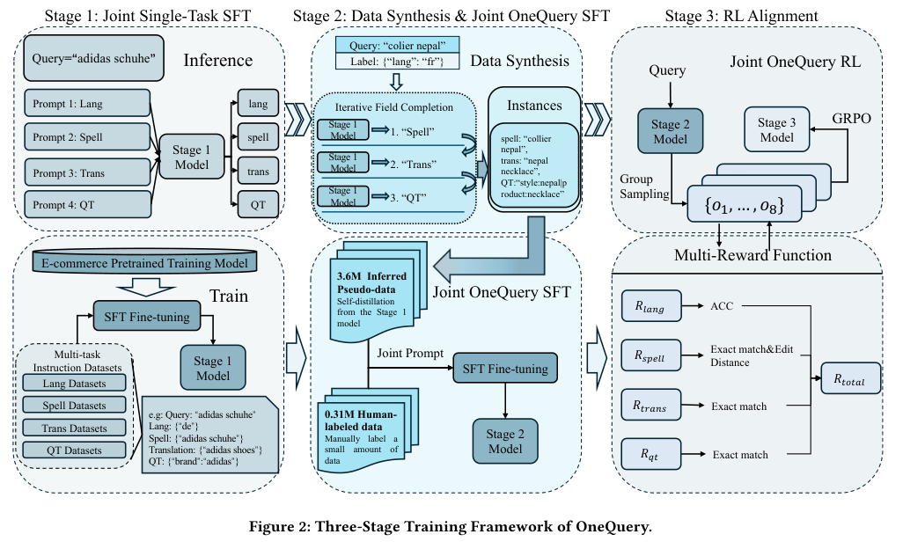
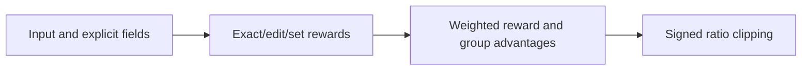

# OneQuery: Unified Sequence-to-Structure Generation for Multilingual E-commerce Query Understanding

[English](README-en.md)

> L1机制诊断，不是完整能力复现；高成本完整实验不复现（审查 DONE），不接Evolve晋级。

## 论文信息

| 字段 | 内容 |
| --- | --- |
| 论文链接 | [Fixed 2611.33653v1](https://arxiv.org/pdf/2611.33653v1) |
| 公司 / 一作机构 | Mingyu Zhang; Xiamen University; co-first author Jiejie Qin, Alibaba Group; Harbin Institute of Technology collaborator |
| 首次公开日期 | 2026-11-25T02:19:27Z; 发现/审查 2026-11-26; 已核公告日 2026-11-26 |
| 原作者开源代码 | 固定v1未给专属作者仓库；本轮未找到已核验公开方法代码，未找到/尚未发布，不把引用仓库当本文实现 |
| 本地adapter / key | `onequery`; `adapter: null`, 独立组件 |
| 本地复现代码 | `src/auto_research/reproductions/onequery_components.py` |

## 原始论文总结

### 背景与主要改动

OneQuery把语言识别、纠错、英语翻译和查询标注作为同一次schema引导JSON生成，而不是四个独立模型逐级传错。Stage1混合四类单任务SFT；Stage2从部分标注中保留真值、用Stage1补齐缺字段，清洗后混合3.6M伪标注与310K人工样本；Stage3用任务特定reward做GRPO。生产端14B离线缓存头部查询，蒸馏0.3B学生实时处理尾部。

<!-- paper-figure:start -->
### 原论文关键图

[](https://arxiv.org/pdf/2611.33653v1#page=4)

图片来自[原论文](https://arxiv.org/pdf/2611.33653v1#page=4)固定v1第4页，完整保留图注，版权归原作者所有；已目视核对，不是本地结果。 [Provenance/SHA256](assets/provenance.json).
<!-- paper-figure:end -->



### 核心公式

Eq7的默认非均匀权重来自§5.4 reward-v4：(0.35,0.25,0.25,0.15)。比较前做NFKC、小写与空白规整。语言和翻译严格exact match；QT比较完整(type,text)集合，不是F1。需要纠错时，正确串得1，否则只给0.3倍归一化Levenshtein相似度；无需纠错时，只有保留原串得1。Eq5为组内均值/标准差优势，Eq6同时处理正负优势的clipped ratio。

### 论文离线与线上效果

Table1的14B pipeline→Stage3：语言Acc0.9514→0.9665，Translation ROUGE-2 78.20→80.50，纠错F1 0.8568→0.8717，QT F1 0.8128→0.8366。§5.6在AliExpress多国真实A/B，对照是现有线上QU系统；L2P+0.5%、SBS人工相关性+0.8pt。未披露流量比例、样本数、持续时长或置信区间；不能把SBS百分点写成相对百分比。线上收益属于完整缓存/学生/下游链路，不是reward算子的本地效果。

### 与已有方法的关系

LARF把单文档相关性建成五维ordinal标签，并使用PNR、规则反馈和terminal digit margin；OneQuery监督的是同一query的四个异构结构字段。OneQuery的QT reward是完整集合exact match，不能换成LARF的分级距离或文档间有序pair。LARF训练期生成head/服务分类head也不等于OneQuery的头部缓存/尾部蒸馏。两篇作者线上指标不可直接比较。

## 本地复现

### 数据协议与代码映射

本地只执行Eq5–13的reward、优势和clipping算术。QT输入为显式tuple列表，不发明私有标注串的parser；无效schema直接拒绝，不猜造格式reward。空串对空串编辑相似度取1、sigma采用总体标准差、delta=1e-8是显式边界约定。没有语言模型、schema约束解码、部分标注补齐、SFT、GRPO参数训练、蒸馏或服务；gold只作为reward计算输入，不存在读取gold的Agent。

```bash
PYTHONPATH=src python -c 'from auto_research.reproductions.onequery_components import diagnostic; print(diagnostic(42))'
PYTHONPATH=src python -m pytest tests/test_nov26_industrial_components.py -q
```

### 结果、负控与边界

CPU三seed仅生成小组随机reward，验证NFKC/顺序不变、缺一个QT实体即0、无需纠错的改写为0、partial reward不超过0.3、常数组优势为0和正负ratio截断。显式权重按原值加权，不自动二次归一。所有结果为L1机制诊断，既不衡量查询理解准确率，也不支持Evolve晋级。

冻结源绑定三seed产物仅为诊断；CUDA组件另需真实A100/A30证据。 [CPU](metrics/component-cpu-seeds42-44.json).

### 高成本完整实验

§5.1以ME-LLM5.2-14B（另有4B/8B）做完整三阶段，16×A100-80GB，3.6M伪标注+310K人工样本、31K RL query、每query8次采样；另含私有评测19,087条和线上蒸馏/缓存/A/B。总GPU小时未披露，不能从0.3B服务学生反推训练便宜。成本过高，不复现（审查 DONE）；不下载模型或训练数据、不探跑、不重试。
