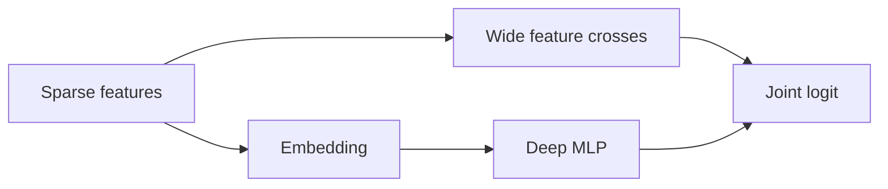
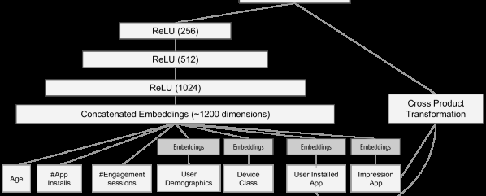

# Wide & Deep

<!-- source-sha256: ce3072148a53f5c5d0b37429ed96404ac3fe1452571bf9d9d41ee59c20686ab5 -->

[简体中文](README.md)

> **Fidelity: core mechanism.** Combines memorizing wide feature crosses with a generalizing deep tower.

## Paper information

| Field | Details |
|---|---|
| Paper | [arXiv 1606.07792](https://arxiv.org/abs/1606.07792) |
| Organization | Google |
| First public release | 2016-06-24 (arXiv v1) |
| Authors' code | [Public implementation](https://github.com/tensorflow/models/tree/master/official/r1/wide_deep) |
| Adapter / method | `wide-deep` |
| Local reproduction code | [`src/auto_research/reproductions/wide_deep/`](https://github.com/daiwk/auto-research/tree/main/src/auto_research/reproductions/wide_deep/) |

## Original paper

### Motivation and method

Linear models memorize sparse co-occurrences but generalize poorly. A pure DNN generalizes but may recommend irrelevant combinations. The paper trains both paths jointly and shares the final logit.



<!-- paper-figure:start -->
### Key figure from the paper

[](https://ar5iv.labs.arxiv.org/html/1606.07792/assets/x4.png)

> **Figure 4:** Core architecture, modules, and their connections. From the [original paper](https://arxiv.org/abs/1606.07792); copyright remains with the authors.
<!-- paper-figure:end -->

### Core equation

$$
p(y=1\mid x)=\sigma(w_{\rm wide}^{\top}[x,\phi(x)]+w_{\rm deep}^{\top}h_L+b).
$$

### Paper results

In a three-week Google Play online experiment, Wide & Deep increased app acquisitions by **3.9%** against the wide control and about **1%** against the deep model.

## Local reproduction

> **Local comparison:** The baseline is a parameter-matched deep-only model; the treatment adds a wide path crossing candidate and genre. Three-seed full-catalog MovieLens-100K NDCG@10 improves **+5.45%** relative.

```bash
auto-research reproduce --paper wide-deep
```

See the [structured results](metrics/movielens-100k-seeds42-44.json).

## Reproduction boundaries

Public MovieLens substitutes for private Google Play logs. Production feature engineering, distributed training, and serving were not reproduced.
