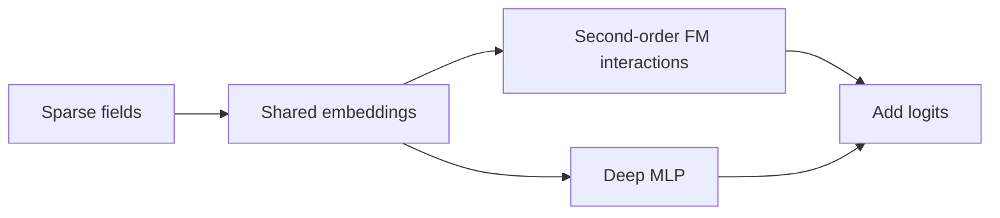
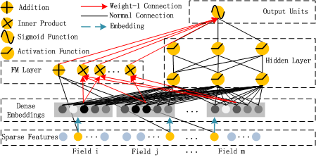

# DeepFM: shared embeddings for factorization machines and deep networks

<!-- source-sha256: 4859d2a24b115d6915e25462c48c4ea2de22afe45a4711354e08e767b70e92f1 -->

[简体中文](README.md)

> **Core mechanism.** Jointly trains second-order FM interactions and a deep branch. Private industrial features and online systems are outside scope.

## Paper information

| Field | Details |
|---|---|
| Paper | [arXiv 1703.04247](https://arxiv.org/abs/1703.04247) |
| Organization | Huawei Noah's Ark Lab |
| First public release | 2017-03-13 (arXiv v1) |
| Authors' code | The paper did not provide official or author code when checked on 2026-08-09. |
| Adapter / method | `deepfm` |
| Local reproduction code | [`src/auto_research/reproductions/deepfm/`](https://github.com/daiwk/auto-research/tree/main/src/auto_research/reproductions/deepfm/) |

## Original paper

### Motivation and method

CTR ranking needs both low-order feature combinations and high-order nonlinear interactions. Wide & Deep needs manual wide features; DeepFM shares field embeddings across both paths end to end. The model adds first- and second-order FM terms to an MLP output, reducing manual crosses and duplicate parameters.

<!-- paper-figure:start -->
### Key figure from the paper

> **Figure 1:** Core architecture, modules, and connections. From the [original paper](https://arxiv.org/abs/1703.04247); copyright remains with the authors.
<!-- paper-figure:end -->

### Core equation

$$
\hat y=\sigma\left(w_0+\sum_i w_i x_i+
\sum_{i<j}\langle v_i,v_j\rangle x_ix_j+y_{\mathrm{DNN}}\right).
$$

### Paper results

On Criteo and enterprise data, the paper compares AUC/log loss and reports better results than FM and deep-only models. This approved classic exception does not lower the online-evidence threshold for new industrial papers.

## Local reproduction

> **Local comparison:** The embedding MLP baseline and shared-embedding FM + deep treatment differ in the FM branch. NDCG@10 improves **+23.58%** relative; see `metrics/movielens-100k-seeds42-44.json`.

- Data: complete downloaded MovieLens-100K, with a fixed compact local training subset.
- Matched baseline: an embedding MLP using the same embeddings, training steps, and negative sampling.
- Method: real second-order FM terms plus the deep branch, not a hand-built scoring proxy.
- Run: `auto-research reproduce --paper deepfm --dataset-dir data`.

Across three seeds, NDCG@10 moves `0.02743→0.03390` and Hit@10 `0.05556→0.06667`. Results have separate JSON and Markdown artifacts; checkpoints are not committed.
