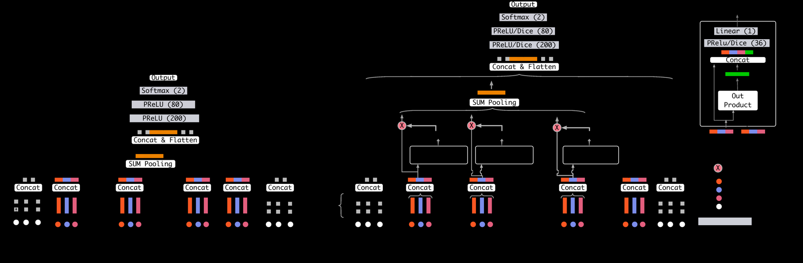

# DIN: Deep Interest Network

<!-- source-sha256: 53e62c18b6597a7e1d63e1dcb58bcee8d03a12a6c71119bf882195e7df3a1f05 -->

[简体中文](README.md)

> **Fidelity: core mechanism reproduction.** Trains candidate-aware activation, weighted interest pooling, Dice and the CTR network. No Alibaba sparse features, mini-batch-aware regularization or production serving.

## Paper information

| Field | Details |
|---|---|
| Paper | [Paper or original source](https://arxiv.org/abs/1706.06978) |
| Institution | Alibaba |
| First public release | 2017-06-21 (arXiv v1) |
| Author code | Yes: [author code](https://github.com/zhougr1993/DeepInterestNetwork). |
| Local adapter or method key | `din` |
| Local reproduction code | [`src/auto_research/reproductions/din/`](https://github.com/daiwk/auto-research/tree/main/src/auto_research/reproductions/din/) |

## Paper method and evidence

A static user vector mixes behaviors unrelated to the current candidate. DIN uses candidate-conditioned local activation weights to pool relevant historical events before CTR scoring. Dice adapts its activation boundary to the feature distribution through batch statistics. Local click scoring uses BCE on positives and negatives.


<!-- paper-figure:start -->
### Original paper figure

[](https://ar5iv.labs.arxiv.org/html/1706.06978/assets/images/omni/DIN_new.png)

Figure 2 shows the candidate-aware interest architecture. From the [original paper](https://arxiv.org/abs/1706.06978); copyright remains with the authors.
<!-- paper-figure:end -->

### Core equation

$$
a_i=g(q,e_i,q-e_i,q\odot e_i),\qquad
v_U(q)=\sum_i \operatorname{softmax}(a)_i e_i.
$$

For candidate $q$ and behavior $e_i$, local activation learns a candidate-specific weight. Dice uses $p(s)=\sigma(\mathrm{BN}(s))$ and $\mathrm{Dice}(s)=p(s)s+(1-p(s))\alpha s$.

### Reported results

MovieLens-20M AUC: DIN 0.7337, DIN+Dice 0.7348; Amazon: 0.8818 and 0.8871. Alibaba production A/B in May–June 2017 reports CTR +10.0% and RPM +3.8%. These use different data/features/protocol from local results.

## Local reproduction

Automatically downloaded MovieLens-100K yields 932 valid users and 1,682 items. Chronological leave-two-out and full-catalog ranking. Candidate-aware DIN and the mean-pooling control share embeddings, MLP, parameters and training budget: 320 steps per seed 42/43/44 on Apple MPS.

| Model | Hit@10 | NDCG@10 | Head share@10 |
|---|---:|---:|---:|
| Mean pool | 0.03720 ± 0.00220 | 0.01783 ± 0.00188 | 0.99871 |
| DIN | 0.03577 ± 0.00220 | 0.01659 ± 0.00152 | 0.99950 |

NDCG drops 6.97% relative. Both losses decline but rankings almost collapse to popular items. Small genre-only public proxy data demonstrate an executable core, not production gains or a rebuttal to the authors' multi-domain sparse-feature results. [Audited metrics](metrics/movielens-100k-seeds42-44.json).

```bash
AUTO_RESEARCH_DIN_STEPS=320 auto-research reproduce --paper din --seed 42
```
