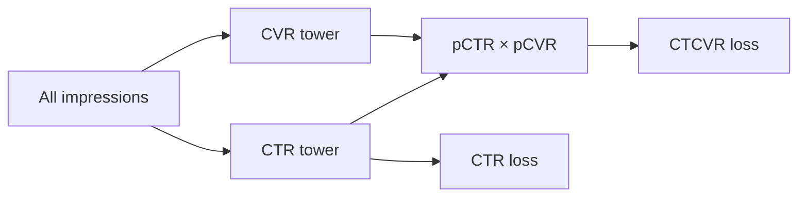
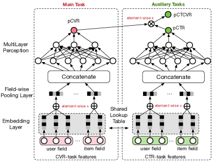

# ESMM: joint click and conversion modeling over the entire space

<!-- source-sha256: 554c12e66b1c6801ab110d14b5b83f2559bb3ce2810225670e9c2ecb49650219 -->

[简体中文](README.md)

> **Core mechanism.** Runs CTR/CVR towers, a probability product, and an entire-space loss. Public data stand in for private Taobao funnel records.

## Paper information

| Field | Details |
|---|---|
| Paper | [arXiv 1804.07931](https://arxiv.org/abs/1804.07931) |
| Organization | Alibaba |
| First public release | 2018-04-21 (arXiv v1) |
| Authors' code | The paper did not provide official or author code when checked on 2026-08-09. |
| Adapter / method | `esmm` |
| Local reproduction code | [`src/auto_research/reproductions/esmm/`](https://github.com/daiwk/auto-research/tree/main/src/auto_research/reproductions/esmm/) |

## Original paper

### Motivation and method

CVR is observed only for clicked impressions, so direct training encounters sample-selection bias. Conversions are also much sparser than clicks. ESMM jointly learns CTR and CVR over all impressions and uses the probability chain rule to derive CTCVR. Dense CTR supervision stabilizes representations in the CVR tower.

<!-- paper-figure:start -->
### Key figure from the paper

> **Figure 2:** Core architecture, modules, and their connections. From the [original paper](https://arxiv.org/abs/1804.07931); copyright remains with the authors.
<!-- paper-figure:end -->

### Core equation

$$
p(\mathrm{click\&conversion}\mid x)
=p(\mathrm{click}\mid x)\,p(\mathrm{conversion}\mid \mathrm{click},x).
$$

### Paper results

The paper reports AUC and calibration gains on Ali-CCP and industrial logs. This entry was approved as a classic exception.

## Local reproduction

> **Local comparison:** The baseline trains CVR only in clicked space. The treatment jointly learns CTR and CTCVR over the entire space. Average task AUC improves **+1.69%** relative; see `metrics/movielens-100k-seeds42-44.json`.

- Data: MovieLens-100K, with ratings ≥3 for clicks and ≥4 for conversions, plus entire-space negatives.
- Baseline: train the CVR tower in clicked space only.
- Method: train CTR and product-based CTCVR jointly over the entire space.
- Run: `auto-research reproduce --paper esmm --dataset-dir data`.

Across three seeds, conversion AUC moves `0.55590→0.56697` (`+1.99%`), and average task AUC `0.55928→0.56872`.
