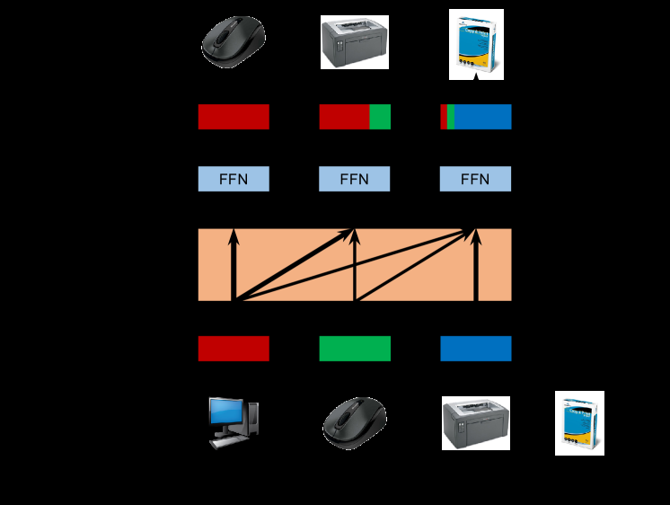

# SASRec: Self-Attentive Sequential Recommendation

<!-- source-sha256: c49e5b307f0255420d1281b299c2908d4a2086410ea8238ce32ddcc64fc9fca2 -->

[简体中文](README.md)

> **Fidelity: Full core pipeline.** The model, paper's pairwise BCE training objective, and sequential inference all run. Public data is scaled from MovieLens-1M to MovieLens-100K and evaluated with a stricter full-catalog protocol.

## Paper information

| Field | Value |
| --- | --- |
| Paper link | [arXiv 1808.09781](https://arxiv.org/abs/1808.09781) |
| Organization | UC San Diego |
| First published | 2018-08-20 (arXiv v1) |
| Original author code | Yes: [official author code](https://github.com/kang205/SASRec). |
| Adapter | `sasrec` |
| Local reproduction code | [`src/auto_research/reproductions/sasrec/`](https://github.com/daiwk/auto-research/tree/main/src/auto_research/reproductions/sasrec/) |

## Original paper summary

### Background and main changes

Markov chains favor recent behavior; RNNs compute step by step. SASRec uses causal self-attention to select behaviors relevant to the next item, giving a more flexible receptive field across sparse and dense data. It became a common sequential recommendation baseline.


<!-- paper-figure:start -->
### Key figure from the paper

[](https://ar5iv.labs.arxiv.org/html/1808.09781/assets/x1.png)

**Original Figure 1 (training):** Training flow and key optimization steps. Image from the [original paper](https://arxiv.org/abs/1808.09781); copyright belongs to the authors. Click the image for its source.
<!-- paper-figure:end -->

### Core equation

For sequence representation $E$, each layer computes:

$$
\operatorname{Attn}(E)=\operatorname{softmax}\left(\frac{QK^\top}{\sqrt d}+M_{causal}\right)V,
\qquad F_i=\operatorname{ReLU}(S_iW_1+b_1)W_2+b_2.
$$

Input item embeddings and output classifier weights are tied. Pairwise BCE over the positive item and a sampled negative at each position preserves the paper's objective.

### Offline and online results in the paper

- Offline: with the ground-truth item and 100 sampled negatives, Hit@10/NDCG@10 are 0.4854/0.3219 on Beauty, 0.7410/0.5360 on Games, 0.8729/0.6306 on Steam, and 0.8245/0.5905 on MovieLens-1M.
- Online: no production A/B is reported.

SASRec is a user-approved named exception for a classic baseline, not a change to the quantified online A/B requirement for new industrial papers.

## Local reproduction

> **Control:** Popularity versus SASRec. NDCG@10 falls from 0.02969 to 0.02933 (**-1.24%**). This compares models, not a SASRec component ablation.

MovieLens-100K has 932 eligible users and 1,682 items, with chronological leave-two-out. Seeds 42/43/44 each run 320 steps on Apple MPS. Full-catalog evaluation is substantially harder than 100 sampled negatives, so absolute scores are not comparable with the paper.

| Model | Hit@10 | NDCG@10 | Head share@10 |
|---|---:|---:|---:|
| Popularity | 0.06009 | 0.02969 | 1.00000 |
| SASRec | 0.05830 ± 0.00395 | 0.02933 ± 0.00051 | 0.97775 |

SASRec NDCG@10 is **-1.24%** relative to popularity. Three seeds give similar results without beating the strong popularity baseline. The run provides a reusable neural sequence baseline with a clear protocol and exposes head bias under a short budget.

See [metrics/movielens-100k-seeds42-44.json](metrics/movielens-100k-seeds42-44.json).

## Reproduction command

```bash
AUTO_RESEARCH_SASREC_STEPS=320 auto-research reproduce --paper sasrec --seed 42
```
