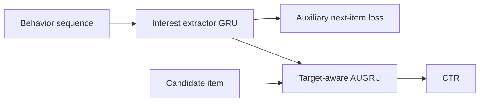
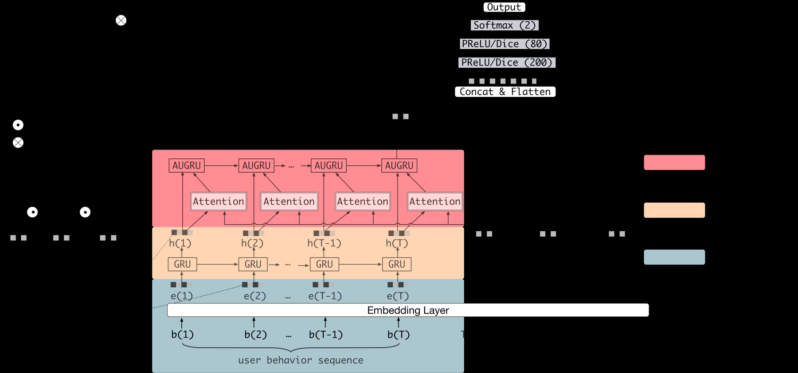

# DIEN

<!-- source-sha256: e9d7d8ac69a39dd3084cdd51bee1934223f505c40d9ada943bb5e6866455f989 -->

[简体中文](README.md)

> **Core-mechanism reproduction.** Interest GRU, next-behavior supervision, and target-dependent evolution.

## Paper information

| Field | Value |
| --- | --- |
| Paper | [arXiv 1809.03672](https://arxiv.org/abs/1809.03672) |
| Affiliations | Alibaba |
| First public release | 2018-09-11 (arXiv v1) |
| Authors' code | [Author code](https://github.com/mouna99/dien). |
| Adapter / method | `dien` |
| Local code | [`src/auto_research/reproductions/dien/`](https://github.com/daiwk/auto-research/tree/main/src/auto_research/reproductions/dien/) |

## Original paper

### Background and contribution

Unlike DIN's direct interest activation, DIEN extracts stepwise interest with auxiliary supervision, then lets the target item control state evolution.



<!-- paper-figure:start -->
### Key figure from the paper

[](https://ar5iv.labs.arxiv.org/html/1809.03672/assets/image/dein.png)

Original Figure 1: DIEN architecture. From the [paper](https://arxiv.org/abs/1809.03672); copyright belongs to the authors. Not a local result.
<!-- paper-figure:end -->

### Core mechanism

$$
L=L_{\rm ctr}+\alpha L_{\rm aux},\qquad
\tilde u_t=a_tu_t,\quad h_t=(1-\tilde u_t)h_{t-1}+\tilde u_t\tilde h_t.
$$

### Paper results

The Taobao display-ad experiment reports CTR **+20.7%**, eCPM **+17.1%**, and PPC **−3.0%**.

## Local reproduction

Compare DIN with GRU, auxiliary loss, and target-aware evolution under the same training protocol. Three-seed NDCG@10 **−1.98%** relative; no paper gain. See [metrics](metrics/movielens-100k-seeds42-44.json).

```bash
auto-research reproduce --paper dien
```

## Reproduction limits

Short sparse MovieLens histories do not replace Taobao ad features. No production fused AUGRU.
