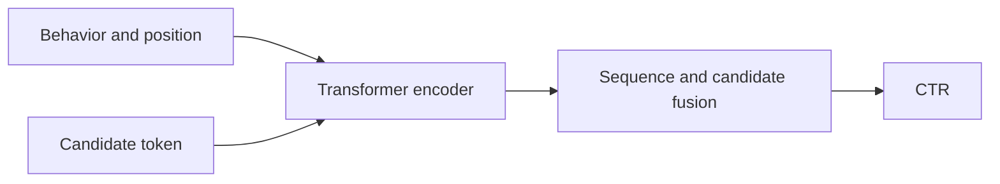
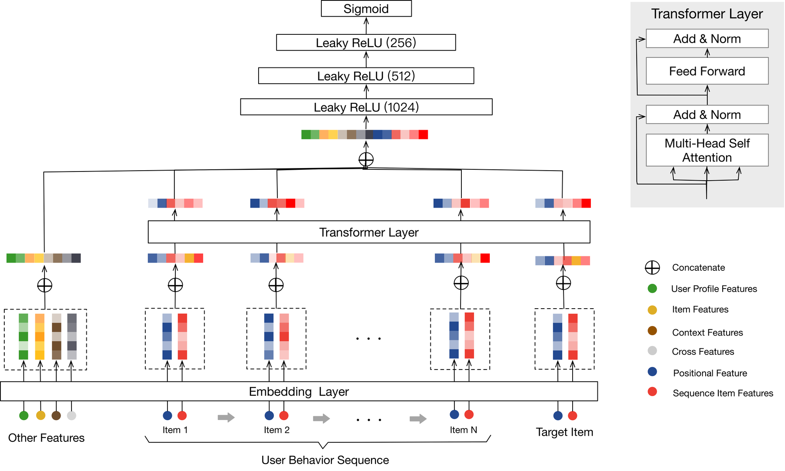

# BST

<!-- source-sha256: 80febd631fd73ce894e36b968f79494d7294c81aa7245d9323717303b8e570e6 -->

[简体中文](README.md)

> **Core-mechanism reproduction.** Candidate token, positional encoding, and behavior Transformer.

## Paper information

| Field | Value |
| --- | --- |
| Paper | [arXiv 1905.06874](https://arxiv.org/abs/1905.06874) |
| Affiliations | Alibaba |
| First public release | 2019-05-15 (arXiv v1) |
| Authors' code | No author code linked by the paper as of 2026-08-09. |
| Adapter / method | `bst` |
| Local code | [`src/auto_research/reproductions/bst/`](https://github.com/daiwk/auto-research/tree/main/src/auto_research/reproductions/bst/) |

## Original paper

### Background and contribution

Use self-attention over behaviors and the candidate together, rather than fixed pooling or single-target attention.



<!-- paper-figure:start -->
### Key figure from the paper

[](https://ar5iv.labs.arxiv.org/html/1905.06874/assets/figures/architecture.png)

Original Figure 1: BST architecture. From the [paper](https://arxiv.org/abs/1905.06874); copyright belongs to the authors. Not a local result.
<!-- paper-figure:end -->

### Core mechanism

$$
H'=\operatorname{softmax}\!\left(\frac{QK^\top}{\sqrt d}\right)V,\qquad
\hat y=\sigma(\operatorname{MLP}([h_{\rm cand},\operatorname{pool}(H')])).
$$

### Paper results

The Taobao recommendation A/B reports **7.57%** higher CTR than WDL.

## Local reproduction

Compare DIN with candidate-in-encoder Transformer. Three-seed NDCG@10 was **+20.29%** relative. See [structured metrics](metrics/movielens-100k-seeds42-44.json).

```bash
auto-research reproduce --paper bst
```

## Reproduction limits

Public data replace Taobao logs. User profiles, context features, and production inference were not reproduced.
