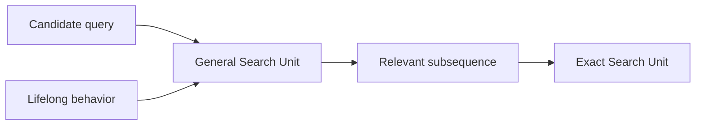
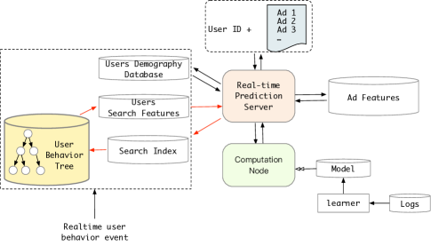

# SIM: Search-based User Interest Modeling with Lifelong Sequential Behavior Data for CTR Prediction

<!-- source-sha256: 6902232492ce98b370c4fab0927d2b88b480b07922db65110e00b5ef31562170 -->

[简体中文](README.md)

> Core mechanism on public data; online and local evidence are separate.

## Paper information

| Field | Details |
|---|---|
| Paper | [CIKM 2020](https://arxiv.org/abs/2006.05639) |
| Institution | Alibaba. |
| First public release | 2020-06-10 (arXiv v1) |
| Author code | No official author code linked by the paper as checked on 2026-08-09. |
| Local adapter or method key | `sim` |
| Local reproduction code | [`src/auto_research/reproductions/sim/`](https://github.com/daiwk/auto-research/tree/main/src/auto_research/reproductions/sim/) |

## Paper method and evidence

Use the candidate item as a query. The General Search Unit retrieves a relevant subsequence from lifelong history; the Exact Search Unit attends to that subsequence for the candidate.



<!-- paper-figure:start -->
### Original paper figure

[](https://ar5iv.labs.arxiv.org/html/2006.05639/assets/x3.png)

The original figure shows general search and exact candidate attention. From the [original paper](https://arxiv.org/abs/2006.05639); copyright remains with the authors.
<!-- paper-figure:end -->

### Core equation

$$
S=\operatorname{TopK}_{i\in H}s_{GSU}(q,i),\quad h_q=\sum_{i\in S}\operatorname{softmax}(q^\top k_i)v_i.
$$

### Reported results

Main Alibaba display-ad traffic reported CTR +7.1%, RPM +4.4%, and histories up to 54,000 events.

## Local reproduction

Shared transition + content is the baseline; SIM changes only the core mechanism. On MovieLens-100K full-catalog ranking, NDCG@10 **0.0354 → 0.0471 (+32.97%)**. [Fixed metrics](metrics/public-seed42.json).

```bash
auto-research reproduce --paper sim --dataset-dir data --seed 42
```

This exercises candidate-conditioned retrieval on public data, not private logs or online serving. The local relative change is not the original traffic lift.
