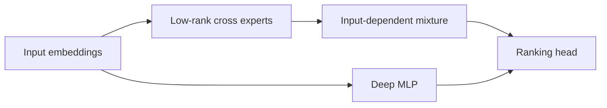
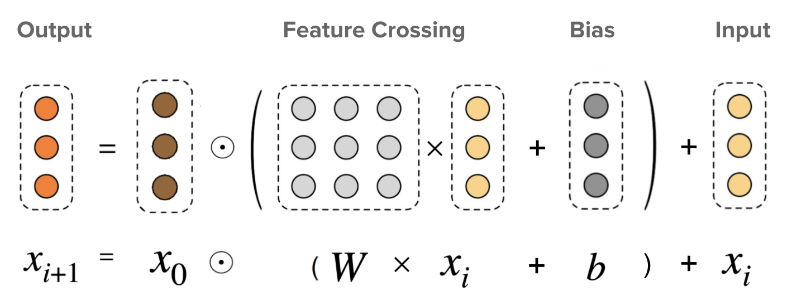

# DCN-V2

<!-- source-sha256: 6a72e8d77b8209eb60b9ae6233b29fb493aa5309d09ccab61ae74b1292f5c64b -->

[简体中文](README.md)

> Core mechanism: low-rank cross experts, input-dependent gating, and a deep tower.

## Paper information

| Field | Details |
|---|---|
| Paper | [arXiv 2008.13535](https://arxiv.org/abs/2008.13535) |
| Institution | Google. |
| First public release | 2020-08-19 (arXiv v1) |
| Author code | No official author code linked by the paper as checked on 2026-08-09. |
| Local adapter or method key | `dcn-v2` |
| Local reproduction code | [`src/auto_research/reproductions/dcn_v2/`](https://github.com/daiwk/auto-research/tree/main/src/auto_research/reproductions/dcn_v2/) |

## Paper method and evidence

Model bounded-degree feature interactions explicitly. Low-rank factors and a mixture of cross experts reduce ranking parameter and compute costs.



<!-- paper-figure:start -->
### Original paper figure

[](https://ar5iv.labs.arxiv.org/html/2008.13535/assets/dcn-formula.png)

Figure 2 gives the original cross-layer formulation. From the [original paper](https://arxiv.org/abs/2008.13535); copyright remains with the authors.
<!-- paper-figure:end -->

### Core equation

$$
x_{l+1}=x_0\odot(W_lx_l+b_l)+x_l,\qquad
W_l=\sum_e g_e(x_l)U_eV_e^\top.
$$

### Reported results

The paper reports improvements over DNN/DCN on Criteo, MovieLens, and private Google data, plus a significant business metric improvement without exact online lift. This is a user-approved classic architecture exception, not quantified A/B evidence.

## Local reproduction

The deep-only baseline is compared with two low-rank cross-expert layers and a gate. Local three-seed NDCG@10 is +22.87% relative. [Structured metrics](metrics/movielens-100k-seeds42-44.json).

```bash
auto-research reproduce --paper dcn-v2
```

No private Google data or production-scale experts; local results only test explicit crossing on public data.
