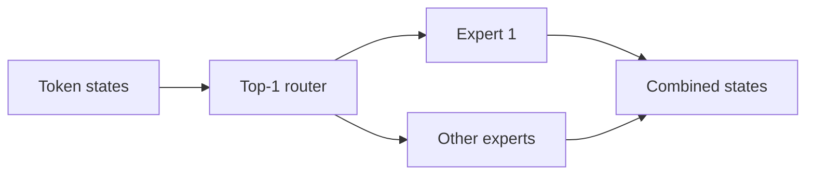
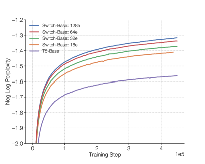

# Switch Transformer

<!-- source-sha256: 71cfc2d850556aa59636dc714b8879095e954f5731b7daca20eb2faf603473b8 -->

[简体中文](README.md)

> Core mechanism: per-token top-1 routing and an auxiliary load-balancing loss.

## Paper information

| Field | Details |
|---|---|
| Paper | [arXiv 2101.03961](https://arxiv.org/abs/2101.03961) |
| Institution | Google Brain. |
| First public release | 2021-01-11 (arXiv v1) |
| Author code | [Author implementation in Mesh TensorFlow](https://github.com/tensorflow/mesh). |
| Local adapter or method key | `switch-transformer` |
| Local reproduction code | [`src/auto_research/reproductions/switch_transformer/`](https://github.com/daiwk/auto-research/tree/main/src/auto_research/reproductions/switch_transformer/) |

## Paper method and evidence

Replace dense FFNs with sparse experts. Each token activates one expert, expanding parameter capacity at approximately fixed FLOPs.



<!-- paper-figure:start -->
### Original paper figure

[](https://ar5iv.labs.arxiv.org/html/2101.03961/assets/x2.png)

Figure 1 illustrates the single-expert routing path. From the [original paper](https://arxiv.org/abs/2101.03961); copyright remains with the authors.
<!-- paper-figure:end -->

### Core equation

$$
e(x)=\arg\max_i p_i(x),\quad y=p_{e(x)}(x)E_{e(x)}(x),\quad
L_{\rm aux}=N\sum_i f_i\bar p_i.
$$

### Reported results

The paper reports about 7× faster pretraining than T5-Base and scales to 1.6T parameters. No online A/B.

## Local reproduction

A parameter-budgeted dense Transformer is the control; the intervention uses four experts and top-1 routing. At 30 WikiText-2 steps, local perplexity was 3.29% lower. [Seed-42 metrics](metrics/wikitext2-seed42.json).

```bash
auto-research reproduce --paper switch-transformer
```

No trillion-parameter training, expert capacity overflow, or cross-device all-to-all was reproduced.
