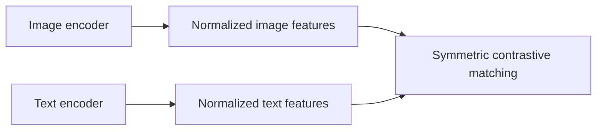
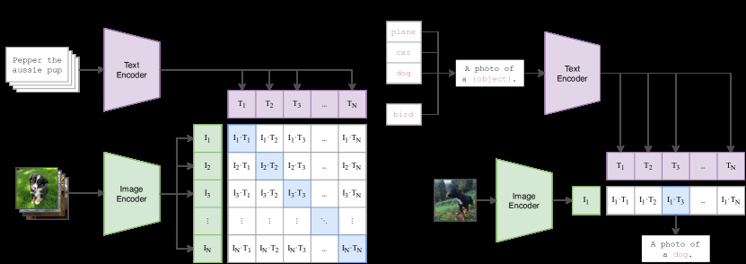

# CLIP: Learning Transferable Visual Models From Natural Language Supervision

<!-- source-sha256: 9a8c03405713d34f4c7af432f78e05830369fa6b5e331a67a6d540983a205fa1 -->

[简体中文](README.md)

> Core dual-encoder mechanism on public images, not paper-scale zero-shot training.

## Paper information

| Field | Details |
|---|---|
| Paper | [arXiv 2103.00020](https://arxiv.org/abs/2103.00020) |
| Institution | OpenAI. |
| First public release | 2021-02-26 (arXiv v1) |
| Author code | [openai/CLIP](https://github.com/openai/CLIP). |
| Local adapter or method key | `clip` |
| Local reproduction code | [`src/auto_research/reproductions/clip/`](https://github.com/daiwk/auto-research/tree/main/src/auto_research/reproductions/clip/) |

## Paper method and evidence

Independent image and text encoders project paired samples to the same unit sphere. A symmetric in-batch contrastive objective learns reusable zero-shot representations.



<!-- paper-figure:start -->
### Original paper figure

[](https://ar5iv.labs.arxiv.org/html/2103.00020/assets/x1.png)

The original figure shows the paired contrastive objective and zero-shot use. From the [original paper](https://arxiv.org/abs/2103.00020); copyright remains with the authors.
<!-- paper-figure:end -->

### Core equation

$$
\mathcal L=\tfrac12\operatorname{CE}(I T^\top/\tau,y)+\tfrac12\operatorname{CE}(T I^\top/\tau,y).
$$

### Reported results

Pretraining uses 400 million image–text pairs. ImageNet zero-shot matches the original supervised ResNet-50; evaluation spans more than 30 datasets.

## Local reproduction

On ten classes of real Fashion-MNIST images paired with class text, uniform random is **10.0%**. The symmetric dual encoder reaches **72.0% (+62.0 percentage points)**; shuffled images reduce it to **10.3%**, confirming dependence on visual input.

```bash
auto-research reproduce --paper clip --dataset-dir data --seed 42
```

[Fixed metrics](metrics/fashion-mnist-qa-seed42.json). No 400M pairs, natural-language long-tail semantics, or large vision encoder. A small one-seed run is not the original zero-shot result.
