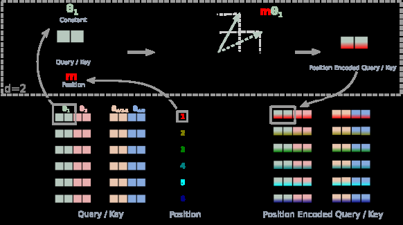

# RoFormer: Enhanced Transformer with Rotary Position Embedding

<!-- source-sha256: 964852564f2b9b0eeb0f9bc32648346062e0332df0e647922752dc5b5bee54c7 -->

[简体中文](README.md)

> **Fidelity: core mechanism.** Paper conclusions, public-data results, and omitted work are reported separately.

## Paper information

| Field | Details |
|---|---|
| Paper | [arXiv 2104.09864](https://arxiv.org/abs/2104.09864) |
| Organization | Zhuiyi Technology |
| First public release | 2021-04-20 (arXiv v1) |
| Authors' code | [Public implementation](https://github.com/ZhuiyiTechnology/roformer) |
| Adapter / method | `rope` |
| Local reproduction code | [`src/auto_research/reproductions/rope/`](https://github.com/daiwk/auto-research/tree/main/src/auto_research/reproductions/rope/) |

## Original paper

### Motivation and method

Rotate two-dimensional Q/K subspaces of each attention head by position, so their dot product depends naturally on relative offsets.


<!-- paper-figure:start -->
### Key figure from the paper

[](https://ar5iv.labs.arxiv.org/html/2104.09864/assets/x1.png)

> **Figure 1:** Overview of the paper's method and key components. From the [original paper](https://arxiv.org/abs/2104.09864); copyright remains with the authors.
<!-- paper-figure:end -->

### Core equations

$$
q_m=R_mW_qx_m,\ k_n=R_nW_kx_n,\quad q_m^\top k_n=x_m^\top W_q^\top R_{n-m}W_kx_n.
$$

### Paper results

The paper reports improvements over absolute position encodings on several long-text classification and language-modeling tasks.

## Local reproduction

> **Local comparison:** Same-budget `llama_modern` baseline and `rope` treatment; relative perplexity +0.00%.

WikiText-2, 12 steps, width 64, two layers, seed 42: PPL 421.18 → **421.18 (+0.00%)**. Parameters, tokens, optimizer, and steps are matched.

```bash
auto-research reproduce --paper rope --dataset-dir data --seed 42
auto-research evolve --model micro-llm --dataset wikitext-2 --direction "组合 rope 与已安装论文算子" --generations 2 --population 4
```

See the [fixed metrics](metrics/public-seed42.json).

## Reproduction boundaries

The local path rotates Q/K in the complex plane for each head and incorporates relative phase into their dot product. A width-64 WikiText-2 model stands in for Chinese RoFormer pretraining. Local values do not represent the paper's large model, private data, production traffic, or custom kernels, and must not be conflated with its gains.
