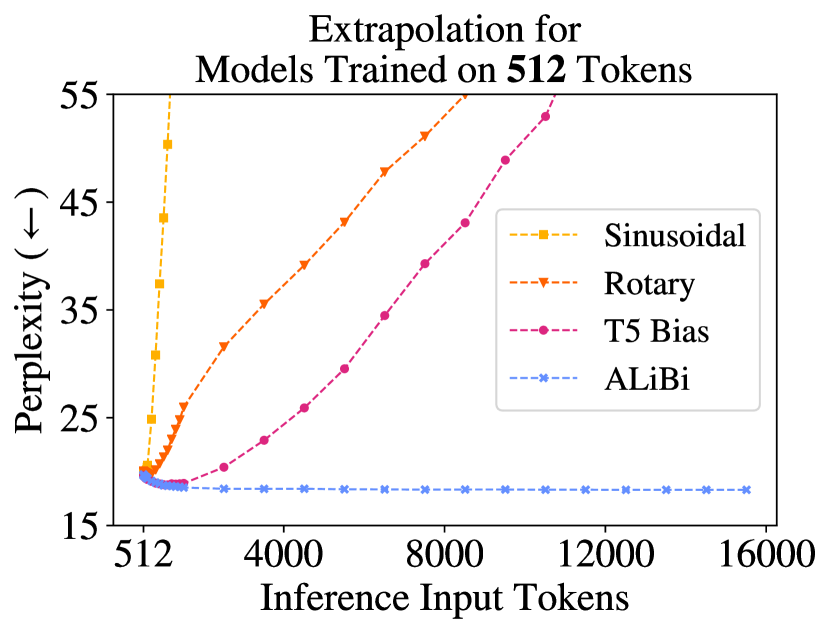

# ALiBi: Train Short, Test Long — Attention with Linear Biases

<!-- source-sha256: a206f2d5e0513cb80e61a88a2a3b362b46547c168947bc8a126bf98f8d0413fe -->

[简体中文](README.md)

> Core linear positional bias, not paper-scale training.

## Paper information

| Field | Details |
|---|---|
| Paper | [arXiv 2108.12409](https://arxiv.org/abs/2108.12409) |
| Institution | University of Washington / Meta AI. |
| First public release | 2021-08-27 (arXiv v1) |
| Author code | [Author code](https://github.com/ofirpress/attention_with_linear_biases). |
| Local adapter or method key | `alibi` |
| Local reproduction code | [`src/auto_research/reproductions/alibi/`](https://github.com/daiwk/auto-research/tree/main/src/auto_research/reproductions/alibi/) |

## Paper method and evidence

Replace learned positional vectors with a head-specific linear distance penalty on attention logits, enabling length extrapolation.


<!-- paper-figure:start -->
### Original paper figure

[](https://ar5iv.labs.arxiv.org/html/2108.12409/assets/x1.png)

The original figure illustrates the linear attention bias. From the [original paper](https://arxiv.org/abs/2108.12409); copyright remains with the authors.
<!-- paper-figure:end -->

### Core equation

$$
\operatorname{softmax}(QK^\top-m_h|i-j|).
$$

### Reported results

The paper trains at 1024 tokens and tests at 2048, matching or beating sinusoidal/rotary baselines.

## Local reproduction

Matched `llama_modern` vs `alibi` on WikiText-2, 12 steps, 64d/two layers, seed 42: PPL **421.18→421.45 (+0.06%)** with identical parameter/token/optimizer/step budget.

```bash
auto-research reproduce --paper alibi --dataset-dir data --seed 42
auto-research evolve --model micro-llm --dataset wikitext-2 --direction "Combine alibi with installed paper operators" --generations 2 --population 4
```

[Metrics](metrics/public-seed42.json). Remove positional embeddings and apply distinct causal distance slopes per head. No WikiText-103 1.3B experiment.
