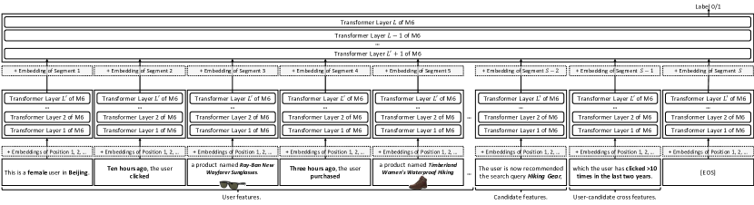

# M6-Rec: Turning a pretrained language model into an open-ended recommender

<!-- source-sha256: 61681de0d65ab22f81e6689e3b59526984d11a02b25587e6124265fb6926fdd1 -->

[简体中文](README.md)

> **Fidelity: core mechanism reproduction.** Frozen pretrained backbone, natural-language behavior, option prototypes and per-layer bottleneck adapters. Private data, production M6 and serving optimizations are not reproduced.

## Paper information

| Field | Details |
|---|---|
| Paper | [Paper or original source](https://arxiv.org/abs/2205.08084) |
| Institution | Alibaba |
| First public release | 2022-05-17 (arXiv v1) |
| Author code | No official author code identified (checked 2026-08-09). |
| Local adapter or method key | `m6rec` |
| Local reproduction code | [`src/auto_research/reproductions/m6rec/`](https://github.com/daiwk/auto-research/tree/main/src/auto_research/reproductions/m6rec/) |

## Paper method and evidence

Separate retrieval, ranking, explanation and dialogue architectures are expensive to maintain. M6-Rec serializes anonymous behavior and candidates in natural language, supporting ranking, retrieval, zero-shot inference, explanations, content generation and dialogue. Option tuning and per-layer option adapters update around 1% task parameters rather than fully fine-tuning M6. Late interaction, early exit, sharing and pruning yield 10M/2M M6-Edge models.


<!-- paper-figure:start -->
### Original paper figure

[](https://ar5iv.labs.arxiv.org/html/2205.08084/assets/x3.png)

Figure 3 shows the main method components. From the [original paper](https://arxiv.org/abs/2205.08084); copyright remains with the authors.
<!-- paper-figure:end -->

### Core equation

$$
h_{l+1}=F_l(h_l;\Theta_l)+A_t^l(F_l(h_l;\Theta_l)),\qquad
A_t^l(h)=W_{up}^l\,\mathrm{GELU}(W_{down}^l h).
$$

$$
p(y\mid x)=\mathrm{softmax}(\tau\,\hat h_{CLS}^{\top}\hat O_y).
$$

For task $t$, freeze backbone $\Theta$ and optimize option $O_t$ and layer adapters $A_t^l$. The local binary classifier compares the normalized representation to two trainable prototypes.

### Reported results

| Task | Production baseline | M6-Rec |
|---|---:|---:|
| AlipayQuery CTR AUC | DIN 0.7332 | 0.7508 |
| TaoProduct CTR AUC | DIN 0.7611 | 0.7995 |
| AlipayMiniApp HitRate@100 | TwinBERT 69.6% | 74.1% |
| Unseen mini-app HitRate@100 | TwinBERT 49.6% | 57.0% |

The online Alipay mini-app comparison reports >+1.0% relative CTR vs a TwinBERT-style dual tower and full rollout from July 2021.

## Local reproduction

Frozen pretrained `prajjwal1/bert-tiny` (4.4M parameters) models histories of previously liked titles/genres and the candidate, split chronologically by user. Option-only trains two prototypes (256 parameters); option-adapter trains them plus two 24-dimensional adapters (12,848 parameters). Three seeds each use 4,000 train/1,000 test and 80 steps.

| Arm | AUC mean ± SD | Relative lift |
|---|---:|---:|
| Option only | 0.53832 ± 0.01724 | — |
| Option-adapter | 0.53890 ± 0.01516 | +0.12% ± 0.41% |

Per-seed relative changes are −0.36%/+0.07%/+0.65%. A weak positive mean with variance is not stable industrial lift. This is an incremental adapter ablation, not a comparison against DIN. [Stable metrics](metrics/movielens-100k-seeds42-44.json). Model cache, data and runs remain Git-ignored; no checkpoint is committed.

```bash
pip install -e '.[plum]'
for seed in 42 43 44; do
  AUTO_RESEARCH_M6REC_STEPS=80 AUTO_RESEARCH_M6REC_EXAMPLES=4000 \
  auto-research reproduce --paper m6rec --dataset-dir data --seed "$seed"
done
```
