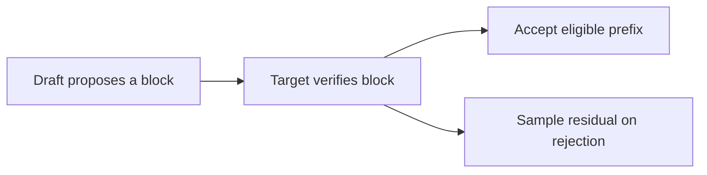
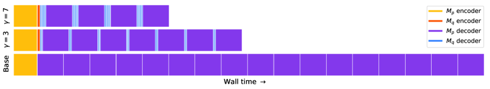

# Fast Inference from Transformers via Speculative Decoding

<!-- source-sha256: fcd6e4a9f72a7f160b354d3ff3b13b82301a16a74b07f8e66c9c8c0d0dc8c9f5 -->

[简体中文](README.md)

> Core mechanism on public data, not paper-scale kernel latency.

## Paper information

| Field | Details |
|---|---|
| Paper | [ICML 2023 Oral](https://arxiv.org/abs/2211.17192) |
| Institution | Google Research. |
| First public release | 2022-11-30 (arXiv v1) |
| Author code | [Google Research speculative_decoding](https://github.com/google-research/google-research/tree/master/speculative_decoding). |
| Local adapter or method key | `speculative-decoding` |
| Local reproduction code | [`src/auto_research/reproductions/speculative_decoding/`](https://github.com/daiwk/auto-research/tree/main/src/auto_research/reproductions/speculative_decoding/) |

## Paper method and evidence

A smaller draft model proposes multiple tokens; the target verifies a whole block. On rejection, sample from the corrected residual distribution, preserving the target distribution.



<!-- paper-figure:start -->
### Original paper figure

[](https://ar5iv.labs.arxiv.org/html/2211.17192/assets/x4.png)

The original figure shows drafting and exact target verification. From the [original paper](https://arxiv.org/abs/2211.17192); copyright remains with the authors.
<!-- paper-figure:end -->

### Core equation

$$
a(x)=\min(1,p(x)/q(x)),\quad p'(x)\propto[p(x)-q(x)]_+.
$$

### Reported results

The paper reports 2–3× speedup on T5-XXL with the same output distribution.

## Local reproduction

Target-only greedy versus four-token draft and exact verification: local `target_calls` **160.0000 → 40.0000 (-75.00%)**. [Fixed metrics](metrics/public-seed42.json).

```bash
auto-research reproduce --paper speculative-decoding --dataset-dir data --seed 42
```

Fit small Markov target/draft token models on WikiText-2 and run proposal, verification and rejection fallback. Calls are not T5-XXL GPU latency.
