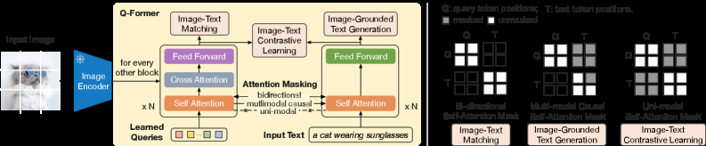

# BLIP-2: Connect frozen vision and language models with Q-Former

<!-- source-sha256: cb8635dd08c94c0b835306c1c9ae9019e5f28f793e04e781417cfcb2611333ad -->

[简体中文](README.md)

> Core query/cross-attention mechanism, not two-stage large-scale pretraining.

## Paper information

| Field | Details |
|---|---|
| Paper | [Paper or original source](https://arxiv.org/abs/2301.12597) |
| Institution | Salesforce Research. |
| First public release | 2023-01-30 (arXiv v1) |
| Author code | [salesforce/LAVIS](https://github.com/salesforce/LAVIS). |
| Local adapter or method key | `blip2` |
| Local reproduction code | [`src/auto_research/reproductions/blip2/`](https://github.com/daiwk/auto-research/tree/main/src/auto_research/reproductions/blip2/) |

## Paper method and evidence

Freeze the image encoder and LLM; train a lightweight Q-Former with learnable queries attending to vision tokens. First learn image–text representations, then project queries as a soft visual prompt for the frozen LLM.


<!-- paper-figure:start -->
### Original paper figure

[](https://arxiv.org/html/2301.12597v3/x2.png)

The original figure shows both stages. From the [original paper](https://arxiv.org/abs/2301.12597); copyright remains with the authors.
<!-- paper-figure:end -->

### Core equation

$$
Z=\operatorname{QFormer}(Q,E_v(I)),\qquad
H_v=WZ,\qquad
\mathcal L_{\mathrm{stage2}}=-\sum_t\log p(y_t\mid H_v,y_{<t}).
$$

### Reported results

The paper reports +8.7 zero-shot VQAv2 points versus Flamingo-80B with 54× fewer trainable parameters, plus caption, VQA and retrieval results. No industrial A/B.

## Local reproduction

Matched mean-pooling connector vs four-query Q-Former: test accuracy **46.8%→41.5% (-5.3 points)** and visual tokens **16→4 (-75%)**. [Metrics](metrics/fashion-mnist-qa-seed42.json). On 2,000 real Fashion-MNIST images and 120 steps, fewer tokens came with worse accuracy. No ViT-g, OPT/FlanT5, or 129M-image ITC/ITM/ITG training.

```bash
auto-research reproduce --paper blip2 --dataset-dir data --seed 42
```
