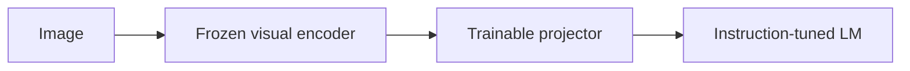
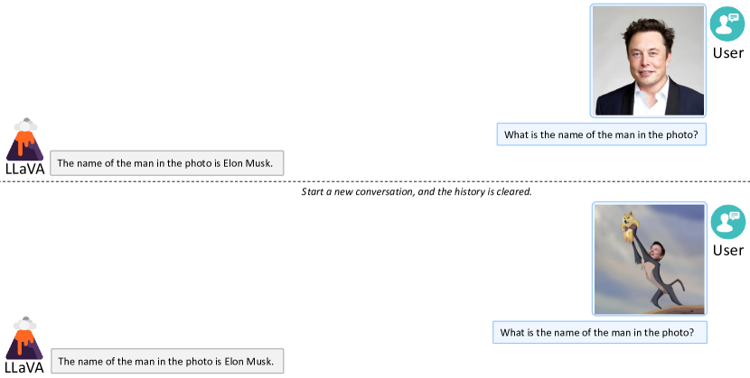

# Visual Instruction Tuning

<!-- source-sha256: 8ff92bf3f10caa2c246ccbb054c2f1a29c5e792ce61ec1495f3dabc44a9bd71f -->

[简体中文](README.md)

> **Core mechanism evidence.** Paper and local evaluations are separate.

## Paper information

| Field | Value |
| --- | --- |
| Paper | [NeurIPS 2023 Oral](https://arxiv.org/abs/2304.08485) |
| Affiliations | University of Wisconsin-Madison / Microsoft Research / Columbia University |
| First public release | 2023-04-17 (arXiv v1) |
| Authors' code | [LLaVA](https://github.com/haotian-liu/LLaVA). |
| Adapter / method | `llava` |
| Local code | [`src/auto_research/reproductions/llava/`](https://github.com/daiwk/auto-research/tree/main/src/auto_research/reproductions/llava/) |

## Original paper

### Background and contribution

Freeze a vision encoder and project its features to the LLM token space, then tune with GPT-4-generated multimodal instructions.



<!-- paper-figure:start -->
### Key figure from the paper

[](https://ar5iv.labs.arxiv.org/html/2304.08485/assets/x7.png)

Original Figure 6: Visual Instruction Tuning. From the [paper](https://arxiv.org/abs/2304.08485); copyright belongs to the authors. Not a local result.
<!-- paper-figure:end -->

### Core mechanism

$$
H_v=W_pE_v(I),\quad\mathcal L=-\sum_t\log p_\theta(y_t|H_v,x,y_{<t}).
$$

### Paper results

The synthetic instruction set achieves 85.1% relative to GPT-4; LLaVA+GPT-4 gives 92.53% ScienceQA.

## Local reproduction

Fashion-MNIST QA: linear projector versus LLaVA-style two-layer MLP, same encoder/head/budget. Test drops 46.8%→43.4% (−3.4 pp); shuffled images 10.6%. [Metrics](metrics/fashion-mnist-qa-seed42.json).

```bash
auto-research reproduce --paper llava --dataset-dir data --seed 42
```

## Reproduction limits

Real pixels and frozen small patch encoder; no GPT-4 data generation or LLaVA-13B. Single-seed projector regression is not large-model instruction tuning.
