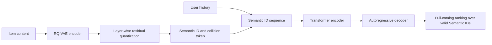
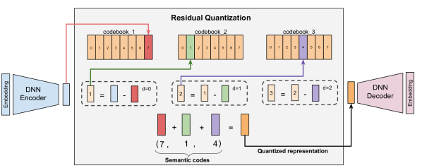

# TIGER: Recommender Systems with Generative Retrieval

<!-- source-sha256: 8baf748cca80fb5364e9dd7280b98de93249f38e0f8f6930149c1c64afee63d5 -->

[简体中文](README.md)

> **Fidelity: core mechanism.** Trains RQ-VAE, residual Semantic IDs, collision tokens, and autoregressive Transformer retrieval. MovieLens genres replace Sentence-T5 item text, and hashed user tokens and cold-start epsilon mixing are omitted.

## Paper information

| Field | Details |
|---|---|
| Paper | [arXiv 2305.05065](https://arxiv.org/abs/2305.05065) |
| Organization | Google / Google DeepMind |
| First public release | 2023-05-08 (arXiv v1) |
| Authors' code | No official or author implementation is linked by the paper (checked 2026-08-09). |
| Adapter / method | `tiger` |
| Local reproduction code | [`src/auto_research/reproductions/tiger/`](https://github.com/daiwk/auto-research/tree/main/src/auto_research/reproductions/tiger/) |

## Original paper

### Motivation and method

Traditional retrieval learns one embedding per item ID, limiting semantic sharing and making new items difficult to generate. TIGER quantizes content vectors into hierarchical Semantic IDs. An encoder-decoder generates the next item as tokens, using an extra token to disambiguate items sharing a prefix.



<!-- paper-figure:start -->
### Key figure from the paper

[](https://ar5iv.labs.arxiv.org/html/2305.05065/assets/x4.png)

> **Figure 3:** Overall design and key components. From the [original paper](https://arxiv.org/abs/2305.05065); copyright remains with the authors.
<!-- paper-figure:end -->

### Core equations

RQ-VAE quantizes residuals layer by layer:

$$
r_0=z_e(x),\quad c_l=\arg\min_j\lVert r_{l-1}-e_{l,j}\rVert^2,\quad
r_l=r_{l-1}-e_{l,c_l}.
$$

The item ID is $(c_1,c_2,c_3,c_{collision})$. The generator maximizes $\sum_t\log p(c_t\mid c_{<t},\mathrm{history})$. Local inference sums token log probabilities for every valid item ID, without score-fusion proxies.

### Paper results

- Offline Amazon Sports/Beauty/Toys: Recall@10 0.0400/0.0648/0.0712 and NDCG@10 0.0225/0.0384/0.0432; relative NDCG@10 gains over the best prior baselines are +10.29%/+17.43%/+14.97%.
- Online: no real production A/B is reported. TIGER is a user-selected classical exception, not a relaxation of the industrial evidence requirement.

## Local reproduction

> **Local comparison.** Parameter- and vocabulary-matched random hierarchical IDs versus TIGER Semantic IDs. NDCG@10 declines from 0.01043 to 0.00635 (**-39.16%**). This ablates ID design, not DIN.

MovieLens-100K uses 19-dimensional genres, 932 eligible users, 1,682 items, and full-catalog generative ranking. RQ-VAE trains for 240 steps and each of three generator seeds for 240 steps. Random IDs share the same four vocabulary sizes and 155,760 parameters, avoiding a smaller-vocabulary advantage.

RQ-VAE loss declines from 0.07172 to 0.01497, but there are just 199 distinct three-level prefixes for 1,682 items, requiring 376 collision-token values. Genres are too coarse.

| ID scheme | Hit@10 | NDCG@10 | Head share@10 |
|---|---:|---:|---:|
| Matched random ID | 0.02039 ± 0.00836 | 0.01043 ± 0.00190 | 0.55755 |
| TIGER semantic ID | 0.01395 ± 0.00488 | 0.00635 ± 0.00182 | 0.39270 |

The pipeline executes, but under coarse genres prefix collisions offset semantic sharing. Amazon item text and Sentence-T5 would be a more faithful next step than increasing decoder steps to mask the content bottleneck. See [audit metrics](metrics/movielens-100k-seeds42-44.json).

## Reproduction command

```bash
AUTO_RESEARCH_TIGER_RQVAE_STEPS=240 AUTO_RESEARCH_TIGER_STEPS=240 \
  auto-research reproduce --paper tiger --seed 42
```
