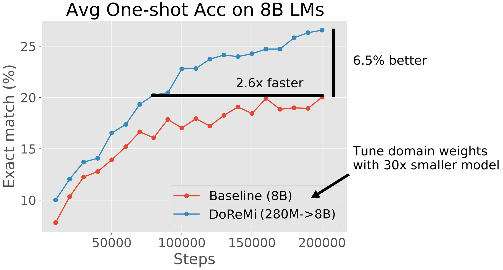

# DoReMi: Optimizing Data Mixtures Speeds Up Language Model Pretraining

<!-- source-sha256: 69074a6f7687f46475834927f506eaed0643f5004dc05577eb347d6ab28632fb -->

[简体中文](README.md)

> Core mixture optimization, not 8B pretraining.

## Paper information

| Field | Details |
|---|---|
| Paper | [Paper or original source](https://arxiv.org/abs/2305.10429) |
| Institution | Stanford University / Google Research. |
| First public release | 2023-05-17 (arXiv v1) |
| Author code | [sangmichaelxie/doremi](https://github.com/sangmichaelxie/doremi). |
| Local adapter or method key | `doremi` |
| Local reproduction code | [`src/auto_research/reproductions/doremi/`](https://github.com/daiwk/auto-research/tree/main/src/auto_research/reproductions/doremi/) |

## Paper method and evidence

Use excess loss from a small proxy for group DRO, increasing underfit domain weights before training the target mixture.


<!-- paper-figure:start -->
### Original paper figure

[](https://ar5iv.labs.arxiv.org/html/2305.10429/assets/figures/pile_8B_fewshot_annotated.png)

Figure shows proxy-based mixture optimization. From the [original paper](https://arxiv.org/abs/2305.10429); copyright remains with the authors.
<!-- paper-figure:end -->

### Core equation

$$
\alpha_d\leftarrow\frac{\alpha_d\exp(\eta[L_d-L_d^{ref}])}{\sum_j\alpha_j\exp(\eta[L_j-L_j^{ref}])}.
$$

### Reported results

On The Pile the paper matches mean 8B baseline performance in fewer steps.

## Local reproduction

WikiText-2 plus public narrative, seed 42: uniform vs DoReMi validation loss **5.6729→5.6645 (-0.15%)**, with matched public tokens and validation. A reference unigram proxy and exponential excess-loss updates run on two domains.

```bash
auto-research reproduce --paper doremi --dataset-dir data --seed 42
auto-research evolve --model micro-llm --dataset wikitext-2 --direction "Combine doremi with installed paper operators" --generations 2 --population 4
```

[Fixed metrics](metrics/public-seed42.json). No The Pile, 280M proxy or 8B target.
