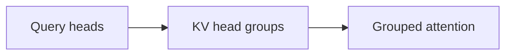
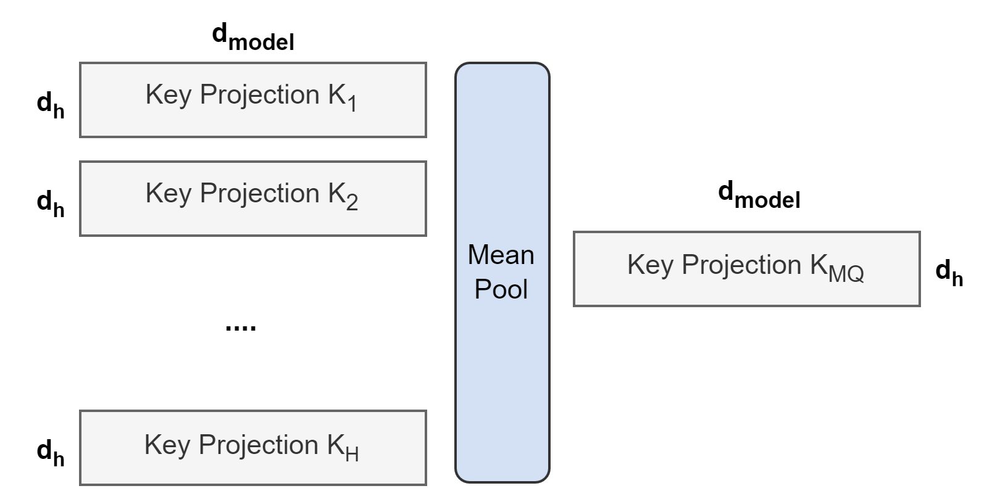

# GQA: Training Generalized Multi-Query Transformer Models from Multi-Head Checkpoints

<!-- source-sha256: ffa7f3cc8df0e83ee807e94334765885f2595cf939dfda1012e18d8eecb56658 -->

[简体中文](README.md)

> **Core mechanism evidence.** Paper and local evaluations are separate.

## Paper information

| Field | Value |
| --- | --- |
| Paper | [arXiv 2305.13245](https://arxiv.org/abs/2305.13245) |
| Affiliations | Google Research |
| First public release | 2023-05-22 (arXiv v1) |
| Authors' code | No official author code linked as of 2026-08-09. |
| Adapter / method | `gqa` |
| Local code | [`src/auto_research/reproductions/gqa/`](https://github.com/daiwk/auto-research/tree/main/src/auto_research/reproductions/gqa/) |

## Original paper

### Background and contribution

Share fewer KV heads among more query heads, balancing MHA quality and MQA decoding bandwidth.



<!-- paper-figure:start -->
### Key figure from the paper

[](https://ar5iv.labs.arxiv.org/html/2305.13245/assets/images/recycling.png)

Original Figure 1: GQA. From the [paper](https://arxiv.org/abs/2305.13245); copyright belongs to the authors. Not a local result.
<!-- paper-figure:end -->

### Core mechanism

$$
Q_h=XW_h^Q,\quad K_h=XW_{g(h)}^K,\ V_h=XW_{g(h)}^V,\quad N_{KV}<N_Q.
$$

### Paper results

Limited MHA checkpoint uptraining produces near-MHA quality and near-MQA speed in the paper.

## Local reproduction

WikiText-2, 12 steps, 64d and two layers, seed 42: matched llama_modern vs. GQA PPL 421.18→430.22 (+2.15%). Match parameters, tokens, optimizer, and steps. [Metrics](metrics/public-seed42.json).

```bash
auto-research reproduce --paper gqa --dataset-dir data --seed 42
auto-research evolve --model micro-llm --dataset wikitext-2 --direction "Combine gqa with installed paper operators" --generations 2 --population 4
```

## Reproduction limits

Four query heads share two KV heads with reported cache reduction. Scratch tiny training is not the paper's 5% uptraining, large models, private data, traffic, or kernels.
