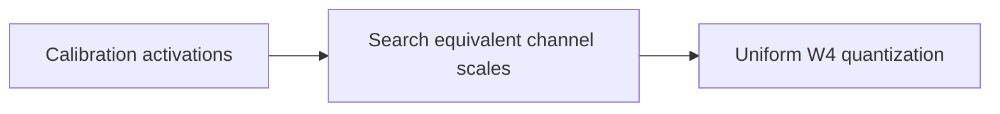
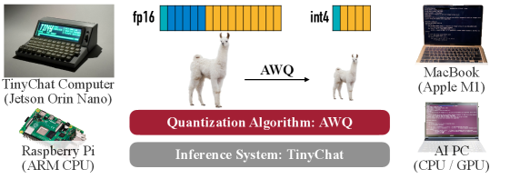

# AWQ: Activation-aware Weight Quantization for LLM Compression and Acceleration

<!-- source-sha256: 70f5ef31bcba296079d2bce8e6321adfd8e208f6a58c042b6d691afb8adfc0ee -->

[简体中文](README.md)

> **Local core-mechanism evidence.** Paper outcomes and local results are separate.

## Paper information

| Field | Value |
| --- | --- |
| Paper | [MLSys 2024 Best Paper](https://arxiv.org/abs/2306.00978) |
| Affiliations | MIT / NVIDIA / Harvard / SJTU |
| First public release | 2023-06-01 (arXiv v1) |
| Authors' code | [Authors' code](https://github.com/mit-han-lab/llm-awq). |
| Adapter / method | `awq` |
| Local code | [`src/auto_research/reproductions/awq/`](https://github.com/daiwk/auto-research/tree/main/src/auto_research/reproductions/awq/) |

## Original paper

### Background and contribution

Use calibration activations to find salient channels. Equivalent channel scaling protects roughly 1% of key weights before hardware-friendly uniform weight-only quantization.



<!-- paper-figure:start -->
### Key figure from the paper

[](https://arxiv.org/html/2306.00978v6/x1.png)

Original Figure 1: AWQ. From the [paper](https://arxiv.org/abs/2306.00978); copyright belongs to the authors. Not a local result.
<!-- paper-figure:end -->

### Core mechanism

$$
XW=(X S^{-1})(S W),\quad S_j=(\mathbb E|X_j|)^\alpha,\quad \alpha^*=\arg\min\|XW-XS^{-1}Q(SW)\|^2.
$$

### Paper results

AWQ outperforms prior PTQ across language, code, math, and multimodal models. TinyChat exceeds FP16 throughput by 3× on desktop and mobile GPUs in the paper.

## Local reproduction

Round-to-nearest W4 versus activation-aware equivalent scaling W4: output MSE 0.0054→0.0052, −4.22%. [Metrics](metrics/public-seed42.json).

```bash
auto-research reproduce --paper awq --dataset-dir data --seed 42
```

## Reproduction limits

Search scales from WikiText-2 activations and actually quantize W4. No TinyChat CUDA kernel; MSE is not throughput.
