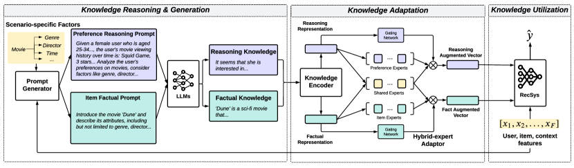

# KAR: Enriching recommendations with open-world LLM knowledge

<!-- source-sha256: 83c75b56d5a9bd06804ebd420e37e3edb53f63791e7751891ce334641cdc569b -->

[简体中文](README.md)

> **Fidelity: complete core pipeline.** Executes factored generation, cache, hybrid experts and CTR training; SmolLM2-135M-Instruct and MovieLens-100K substitute for PanGu and Huawei logs.

## Paper information

| Field | Details |
|---|---|
| Paper | [Paper or original source](https://arxiv.org/abs/2306.10933) |
| Institution | Huawei |
| First public release | 2023-06-19 (arXiv v1) |
| Author code | No official author code identified (checked 2026-08-09). |
| Local adapter or method key | `kar` |
| Local reproduction code | [`src/auto_research/reproductions/kar/`](https://github.com/daiwk/auto-research/tree/main/src/auto_research/reproductions/kar/) |

## Paper method and evidence

Closed-domain recommenders learn interactions but lack item facts and commonsense preferences. Factorization prompting separately elicits user-preference reasoning and factual item knowledge. A hybrid-expert adapter gates shared and specialized experts into ID-compatible features; concatenate with original IDs for BCE prediction. Offline generation and caching avoid online autoregressive latency.


<!-- paper-figure:start -->
### Original paper figure

[](https://ar5iv.labs.arxiv.org/html/2306.10933/assets/x2.png)

Figure 2 shows the recommendation architecture and knowledge flow. From the [original paper](https://arxiv.org/abs/2306.10933); copyright remains with the authors.
<!-- paper-figure:end -->

### Core equation

$$
a(z)=\sum_{e=1}^{E}g_e(z)f_e(z),\qquad g(z)=\mathrm{softmax}(W_gz).
$$

$$
\hat y=R([e_u,e_i,a(z_u),a(z_i)]),\qquad
\mathcal L=-y\log\hat y-(1-y)\log(1-\hat y).
$$

### Reported results

DIN AUC goes 0.7863→0.7961 on MovieLens-1M and 0.8304→0.8418 on Amazon-Books. Nine CTR backbones generally improve AUC about 1%–1.5%; Amazon-Books PRM reranking MAP@7/NDCG@7 rises 5.71%/4.71%. Huawei reports news retrieval +7%. A seven-day music A/B with 10% per arm gives song plays +1.70%, playing devices +1.64% and play time +1.57%.

## Local reproduction

Chronological MovieLens-100K split by user. The model really generates 875 prompts covering 20 users and their items. Final hidden states form cached knowledge vectors. An ID-only ranker scores AUC 0.72188 ± 0.01086 vs 0.72774 ± 0.00627 for KAR with four experts (+0.81% relative). Relative changes −0.67%/+1.95%/+1.19%, 2/3 positive. This small user sample supports a limited trend, not industrial lift; the ablation is against ID-only, not DIN. [Stable metrics](metrics/movielens-100k-seeds42-44.json). Model, knowledge cache, data, runs and checkpoints are not committed.

```bash
pip install -e '.[plum]'
for seed in 42 43 44; do
  AUTO_RESEARCH_KAR_USERS=20 AUTO_RESEARCH_KAR_STEPS=100 \
  AUTO_RESEARCH_KAR_TRAIN=3000 AUTO_RESEARCH_KAR_TEST=600 \
  auto-research reproduce --paper kar --dataset-dir data --seed "$seed"
done
```
