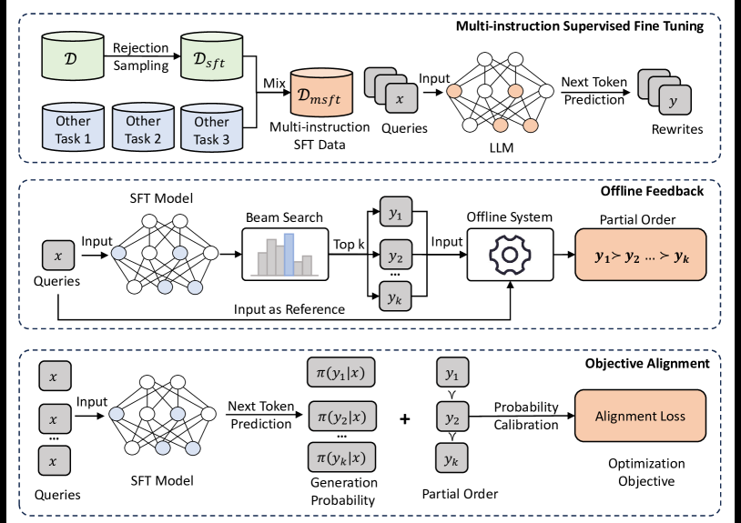

# BEQUE: Aligning LLM query rewrites with offline retrieval feedback

<!-- source-sha256: 12d7b6f1ec21b9e7b0c618c76a05b13f67f7ed8757ca84ad30418a5bbee190fe -->

[简体中文](README.md)

> **Fidelity: complete core pipeline.** Runs genuine seq2seq SFT, beam self-sampling, offline retrieval feedback, preference ordering and PRO. T5-small and MovieLens substitute for Qwen-7B and Taobao.

## Paper information

| Field | Details |
|---|---|
| Paper | [Paper or original source](https://arxiv.org/abs/2311.03758) |
| Institution | Alibaba |
| First public release | 2023-11-07 (arXiv v1) |
| Author code | No official author code identified (checked 2026-08-09). |
| Local adapter or method key | `beque` |
| Local reproduction code | [`src/auto_research/reproductions/beque/`](https://github.com/daiwk/auto-research/tree/main/src/auto_research/reproductions/beque/) |

## Paper method and evidence

Long-tail e-commerce queries have semantic gaps; supervised rewriting alone mimics labels without optimizing retrieval. BEQUE uses rejection sampling and multi-instruction SFT, self-samples rewrites, ranks them on relevance, retrieval increment and hit rate in an offline search system, and learns partial preferences with rank-aware PRO. Serving refreshes rewrites offline and looks them up in a KV store rather than running a 7B LLM per request.


<!-- paper-figure:start -->
### Original paper figure

[](https://ar5iv.labs.arxiv.org/html/2311.03758/assets/x2.png)

Figure 2 shows the feedback-alignment architecture. From the [original paper](https://arxiv.org/abs/2311.03758); copyright remains with the authors.
<!-- paper-figure:end -->

### Core equation

$$
s_\theta(q,y)=\frac{1}{|y|}\sum_t\log p_\theta(y_t\mid q,y_{<t}),
$$

$$
\mathcal L_{PRO}=-\sum_{i=1}^{K-1}\log\frac{\exp(s_i/\tau_i)}{\sum_{j=i}^{K}\exp(s_j/\tau_i)}+\lambda\mathcal L_{SFT}.
$$

For ordered candidates $y_1\succ\cdots\succ y_K$, $s_\theta(q,y)$ is the length-normalized sequence log-probability.

### Reported results

Across all queries, Qwen(SFT) relevance/increment/hit rate is 61.4/109.6/14.58 vs increment-aligned BEQUE's 57.7/198.7/17.27, a tradeoff. The lookup table covers about 27% of PV with almost no added retrieval latency. In Taobao's 14-day A/B, all-query GMV/transactions/UV rise 0.40%/0.34%/0.33%; covered queries rise 2.96%/1.36%/1.22%; `nothing` query GMV rises 18.66%.

## Local reproduction

A public MovieLens title/genre catalog proxies query rewriting. T5-small runs 40 SFT steps, generates four beams per query and uses the inverted catalog to rank relevance, relative incremental retrieval and Hit@1. PRO runs 15 steps on 160 preference groups; each of three seeds uses 600 train/100 test queries. Generated rewrites and unlabeled fallback are used, never the SFT target.

| Metric | SFT mean ± SD | SFT + PRO mean ± SD | Relative change |
|---|---:|---:|---:|
| Combined feedback | 0.62102 ± 0.08473 | 0.80750 ± 0.20024 | +30.03% |
| Hit@1 | 0.32333 ± 0.04041 | 0.51333 ± 0.11930 | +58.76% |
| Relevance | 0.26116 ± 0.04671 | 0.28176 ± 0.07902 | +7.89% |
| Increment | 0.18267 ± 0.03609 | 0.06208 ± 0.01547 | −66.02% |

Combined feedback increases by 0.0056/0.1310/0.4228 across the seeds, with a clear hit-rate vs novelty tradeoff. This supports alignment of the optimized compound objective, not universal submetric gains. It is an SFT vs PRO ablation, not a DIN comparison or industrial log reproduction. [Stable metrics](metrics/movielens-100k-seeds42-44.json). Models/checkpoints are not committed; Taobao data is private.

```bash
pip install -e '.[plum]'
for seed in 42 43 44; do
  AUTO_RESEARCH_BEQUE_SFT_STEPS=40 AUTO_RESEARCH_BEQUE_PRO_STEPS=15 \
  AUTO_RESEARCH_BEQUE_TRAIN=600 AUTO_RESEARCH_BEQUE_TEST=100 \
  auto-research reproduce --paper beque --dataset-dir data --seed "$seed"
done
```
