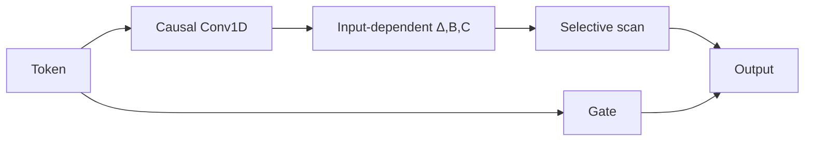
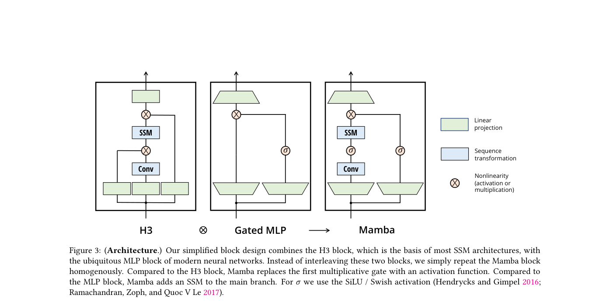

# Mamba

<!-- source-sha256: cc8e64d103688cf6f1eb766728f173a4c9af31eca88def398193334b5ab90220 -->

[简体中文](README.md)

> **Fidelity: core mechanism.** Implements an input-dependent selective SSM, causal depthwise convolution, and gated output.

## Paper information

| Field | Details |
|---|---|
| Paper | [arXiv 2312.00752](https://arxiv.org/abs/2312.00752) |
| Organization | Carnegie Mellon University / Princeton University |
| First public release | 2023-12-01 (arXiv v1) |
| Authors' code | [Public implementation](https://github.com/state-spaces/mamba) |
| Adapter / method | `mamba` |
| Local reproduction code | [`src/auto_research/reproductions/mamba/`](https://github.com/daiwk/auto-research/tree/main/src/auto_research/reproductions/mamba/) |

## Original paper

### Motivation and method

Mamba makes the SSM step size and read/write vectors depend on the current token. This selectively retains information while keeping computation linear in sequence length.



<!-- paper-figure:start -->
### Key figure from the paper

[](https://arxiv.org/pdf/2312.00752#page=8)

> **Figure 3:** Core architecture, modules, and their connections. From the [original paper](https://arxiv.org/abs/2312.00752); copyright remains with the authors.
<!-- paper-figure:end -->

### Core equations

$$
h_t=\exp(\Delta_tA)h_{t-1}+\Delta_tB_t x_t,\qquad y_t=C_t h_t.
$$

### Paper results

The paper matches or beats Transformers on language, audio, and genomics tasks and reports up to about **5×** inference throughput and linear sequence-length scaling. It does not report an online A/B test.

## Local reproduction

> **Local comparison:** A tiny Transformer is the baseline; a native PyTorch selective scan is the treatment. Thirty-step WikiText-2 perplexity is **+48.82%** relative, a deterioration.

```bash
auto-research reproduce --paper mamba
```

See the [structured result](metrics/wikitext2-seed42.json).

## Reproduction boundaries

The fused parallel-scan CUDA kernel and 2.8B-scale pretraining were not used. Short-budget results do not establish paper-scale conclusions.
