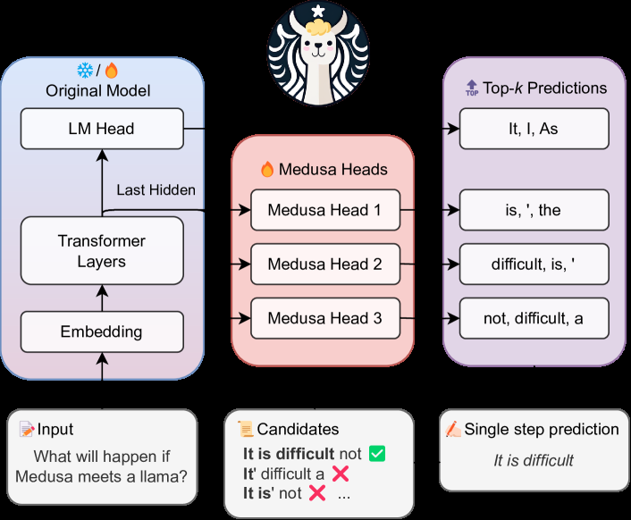

# Medusa: Simple LLM Inference Acceleration Framework with Multiple Decoding Heads

<!-- source-sha256: 24e5d01368dac7a49b08c238fa166bf00402178f02431c11b5af02c8b99b2308 -->

[简体中文](README.md)

> Core mechanism on public data, not production kernel performance.

## Paper information

| Field | Details |
|---|---|
| Paper | [arXiv 2401.10774](https://arxiv.org/abs/2401.10774) |
| Institution | Together AI / Princeton University / University of Illinois Urbana-Champaign. |
| First public release | 2024-01-19 (arXiv v1) |
| Author code | [FasterDecoding/Medusa](https://github.com/FasterDecoding/Medusa). |
| Local adapter or method key | `medusa` |
| Local reproduction code | [`src/auto_research/reproductions/medusa/`](https://github.com/daiwk/auto-research/tree/main/src/auto_research/reproductions/medusa/) |

## Paper method and evidence

Add future-token heads to a frozen or jointly fine-tuned backbone. Verify candidate branches together with tree attention to reduce serial decoding steps.


<!-- paper-figure:start -->
### Original paper figure

[](https://ar5iv.labs.arxiv.org/html/2401.10774/assets/x1.png)

The original figure shows multi-head proposals and tree verification. From the [original paper](https://arxiv.org/abs/2401.10774); copyright remains with the authors.
<!-- paper-figure:end -->

### Core equation

$$
\mathcal L=\sum_{k=1}^K\lambda_k\operatorname{CE}(p_k(x_{t+k}|h_t),x_{t+k}).
$$

### Reported results

The paper reports over 2.2× speedup for Medusa-1 and 2.3–3.6× for Medusa-2 while retaining generation quality.

## Local reproduction

Compare single-head greedy with three future heads and tree verification: local `backbone_calls` **160.0000 → 80.0000 (-50.00%)**. [Fixed metrics](metrics/public-seed42.json).

```bash
auto-research reproduce --paper medusa --dataset-dir data --seed 42
```

The WikiText-2 token transition model exercises future heads, candidate trees and backbone checks; no GPU tree-attention kernel or measured paper-scale latency.
