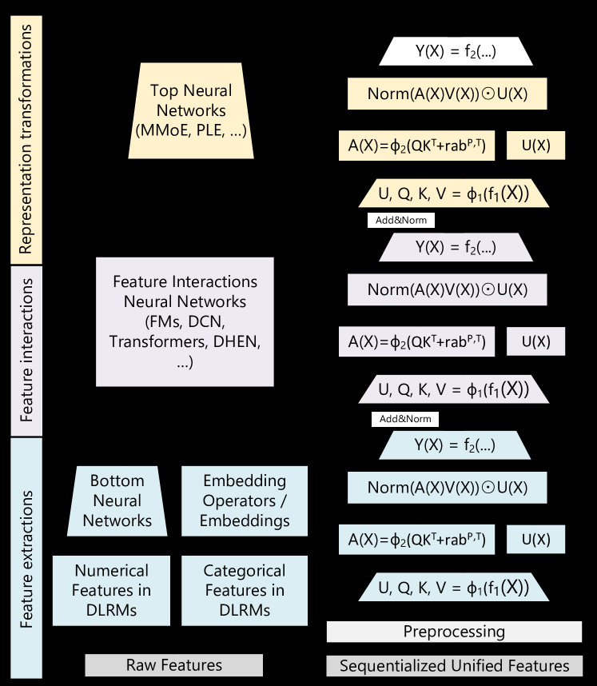

<!-- source-sha256: c10252fe4742f3c575f8e4fce8fdf117de8dd164519c0976ad72c4f40fe3c359 -->

[简体中文](README.md) · English

# HSTU: Hierarchical Sequential Transduction Units

> **Fidelity: core-mechanism reproduction.** Runs UVQK SiLU projection, non-softmax pointwise aggregation, relative position bias, post-pooling normalization, U-gate, residuals, and all-position generative training. It does not reproduce heterogeneous action/time tokens, stochastic-length kernels, M-FALCON, or trillion-parameter serving.

## Paper information

| Field | Details |
| --- | --- |
| Paper | [arXiv 2402.17152](https://arxiv.org/abs/2402.17152) |
| Institution | Meta |
| First public release | 2024-02-27 (arXiv v1) |
| Author code | [Official author code](https://github.com/meta-recsys/generative-recommenders) |
| Local adapter or method key | `hstu` |
| Local reproduction code | [`src/auto_research/reproductions/hstu/`](https://github.com/daiwk/auto-research/tree/main/src/auto_research/reproductions/hstu/) |

## Original paper summary

### Background and main changes

Industrial recommendation histories include different action types and are much longer and larger than conventional next-item data. HSTU unifies recommendation as generative sequence modeling. A transduction layer for sparse long histories replaces the standard Transformer's softmax attention and separate FFN.


<!-- paper-figure:start -->
### Key figure from the paper

[](https://ar5iv.labs.arxiv.org/html/2402.17152/assets/x3.png)

> **Figure 3:** Overall design and components. From the [paper](https://arxiv.org/abs/2402.17152); copyright belongs to the authors. Click for the source.
<!-- paper-figure:end -->

### Core equations

An HSTU layer first computes $U,V,Q,K=\operatorname{SiLU}(\operatorname{Norm}(X)W_{UVQK})$, then

$$
A(X)V=\frac{1}{N}\operatorname{SiLU}(QK^\top+b_{rel})V,
\qquad
X'=X+W_O\left(U\odot\operatorname{Norm}(A(X)V)\right),
$$

with causal masking. Unlike standard attention, there is no softmax normalization. Training uses sampled-softmax next-item prediction at all valid sequence positions.

### Offline and online results

- Offline MovieLens-1M HR@10/NDCG@10: SASRec 0.2828/0.1545, HSTU 0.3043/0.1700 (+7.6%/+10.1%), HSTU-large 0.3306/0.1858.
- In a Meta production ranking A/B test, the generative recommender improves engagement by +12.4% and consumption by +4.4% against DLRM.

## Local reproduction

> **Local comparison:** SASRec is matched for dimensions, layers, heads, loss, and training steps. HSTU NDCG@10 falls from 0.04389 to 0.03611 (**-17.73%**). This is a matched-budget model comparison, not against DIN.

MovieLens-100K has 932 valid users and 1,682 items, with chronological leave-two-out and full-catalog ranking. HSTU and SASRec use 64 dimensions, 2 layers, 2 heads, the same sampled-softmax objective, and 320 steps, with seeds 42/43/44 on Apple MPS.

| Model | Hit@10 | NDCG@10 | Head share@10 |
|---|---:|---:|---:|
| Matched SASRec | 0.09156 ± 0.00182 | 0.04389 ± 0.00160 | 0.90665 |
| HSTU | 0.07761 ± 0.00253 | 0.03611 ± 0.00208 | 0.93877 |

HSTU NDCG@10 is **-17.73%** versus matched SASRec, with the same direction on all three seeds. MovieLens has only one rating event type and shorter histories, lacking the heterogeneous action/time signals HSTU was designed for. This verifies the core layer and training path; the small-data negative result cannot be extrapolated to industrial scale.

See [metrics/movielens-100k-seeds42-44.json](metrics/movielens-100k-seeds42-44.json).

## Reproduction command

```bash
AUTO_RESEARCH_HSTU_STEPS=320 auto-research reproduce --paper hstu --seed 42
```
