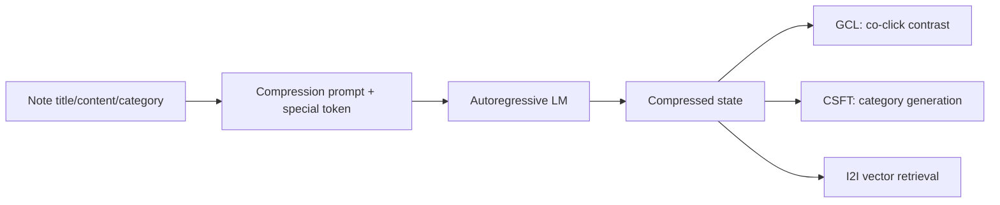
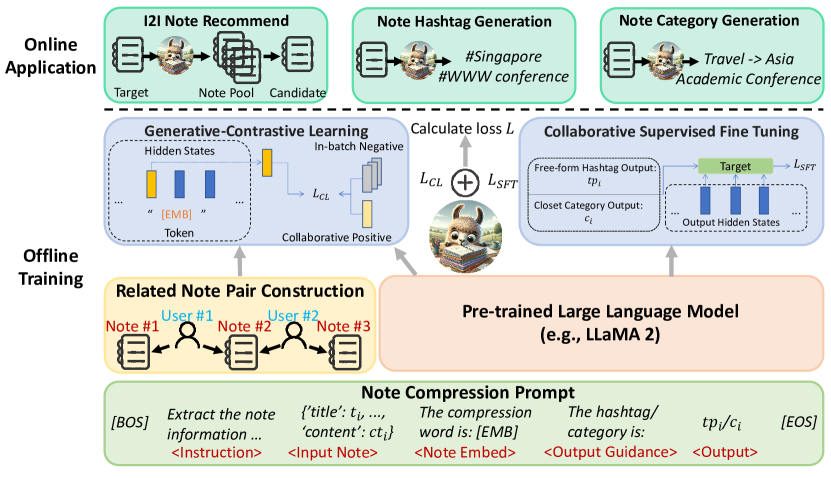

<!-- source-sha256: 4aa86108212bb05ce6539e77fdc171b5a10719def46d15daf08761524e1a394e -->

[简体中文](README.md) · English

# NoteLLM: Adding collaborative signals to a retrievable LLM

> **Fidelity: full core pipeline.** Runs a note-compression special token, behavioral co-occurrence GCL, category-generation CSFT, and I2I retrieval from the compressed state. T5-small and MovieLens replace the 7B LLM and Xiaohongshu notes.

## Paper information

| Field | Details |
| --- | --- |
| Paper | [arXiv 2403.01744](https://arxiv.org/abs/2403.01744) |
| Institution | Xiaohongshu |
| First public release | 2024-03-04 (arXiv v1) |
| Author code | No official or author-released code found in the paper (checked 2026-08-09). |
| Local adapter or method key | `notellm` |
| Local reproduction code | [`src/auto_research/reproductions/notellm/`](https://github.com/daiwk/auto-research/tree/main/src/auto_research/reproductions/notellm/) |

## Original paper summary

### Background and main changes

Text-only embeddings lack collaborative signals, and contrastive learning alone may harm LLM generation. NoteLLM uses one compression prompt to distill content into a special token. GCL pulls co-read notes closer together; CSFT generates hashtags or categories from the same compressed state.



<!-- paper-figure:start -->
### Key figure from the paper

[](https://ar5iv.labs.arxiv.org/html/2403.01744/assets/x2.png)

> **Figure 2:** The core architecture, its main modules, and their connections. From the [paper](https://arxiv.org/abs/2403.01744); copyright belongs to the authors. Click for the source.
<!-- paper-figure:end -->

### Core equations

$$
\mathcal{L}=\mathcal{L}_{GCL}+\lambda\mathcal{L}_{CSFT}.
$$

$$
\mathcal{L}_{GCL}=-\log
\frac{\exp(z_i^\top z_j/\tau)}{\sum_k \exp(z_i^\top z_k/\tau)}.
$$

$$
\mathcal{L}_{CSFT}=-\sum_t\log p(o_t\mid o_{<t},\mathrm{prompt}).
$$

### Offline and online results

Paper Recall@100: SentenceBERT 70.72%, RepLLaMA 83.63%, NoteLLM **84.02%**. In a one-week Xiaohongshu I2I A/B test, CTR rose **+16.20%**, comments +1.10%, weekly publishers +0.41%, and comments on new notes +3.58%.

## Local reproduction

> **Local comparison:** The baseline uses frozen compression-state embeddings; the experimental arm uses NoteLLM GCL+CSFT embeddings. NDCG@10 goes from 0.01142 to 0.01224 (**+7.15%**). This ablates representation training, not an end-to-end ranking gain against DIN.

| Model | Hit@10 | NDCG@10 |
|---|---:|---:|
| Frozen compression state | 0.01931 | 0.01142 |
| NoteLLM GCL + CSFT | **0.02110 ± 0.00223** | **0.01224 ± 0.00037** |

Hit@10 rises +9.26%, NDCG@10 +7.15%, with NDCG up on 3/3 seeds. Public data provides only titles and genres; category generation is easier than generating real hashtags. The result supports only the local trend for the joint objective. See [`metrics/movielens-100k-seeds42-44.json`](metrics/movielens-100k-seeds42-44.json).

```bash
for seed in 42 43 44; do AUTO_RESEARCH_NOTELLM_STEPS=40 auto-research reproduce --paper notellm --dataset-dir data --seed "$seed"; done
```
