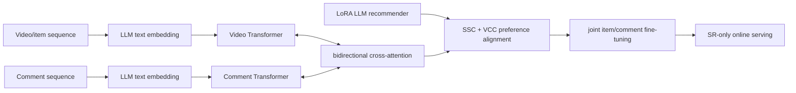
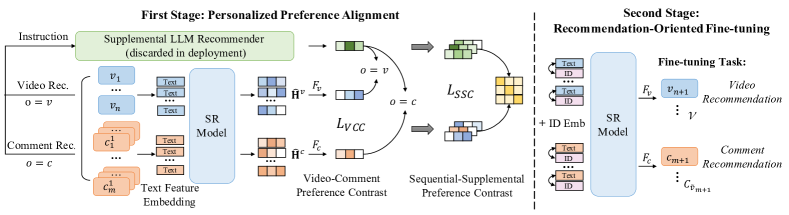

# LSVCR: Aligning LLM recommendation preferences to a deployable dual-sequence model

<!-- source-sha256: 180c4eba64afa2e5ea1784cddd962d91c25a72e50dc6b7be069985c8b9c46c92 -->

[简体中文](README.md)

> **Fidelity: Full core pipeline.** The local run executes causal-LM q/v-LoRA SFT, LLM text encoding, random positional expansion, dual item/comment Transformers, bidirectional cross-attention, SSC/VCC alignment, and joint fine-tuning. Smaller public substitutes replace ChatGLM3 and Kuaishou's private logs.

## Paper information

| Field | Value |
| --- | --- |
| Paper link | [arXiv 2403.13574](https://arxiv.org/abs/2403.13574) |
| Organization | Kuaishou |
| First published | 2024-03-20 (arXiv v1) |
| Original author code | Yes: [official author code](https://github.com/RUCAIBox/LSVCR). |
| Adapter | `lsvcr` |
| Local reproduction code | [`src/auto_research/reproductions/lsvcr/`](https://github.com/daiwk/auto-research/tree/main/src/auto_research/reproductions/lsvcr/) |

## Original paper summary

### Background and main changes

Short-video users consume videos and comments. Sequence models serve efficiently but struggle with comment semantics, while online LLM recommendation is too slow. LSVCR uses an LLM as an offline text encoder and a training-only supplemental recommender. It aligns its personalized preferences to a deployable dual-sequence sequential recommender (SR), which serves without a generative LLM.



<!-- paper-figure:start -->
### Key figure from the paper

[](https://ar5iv.labs.arxiv.org/html/2403.13574/assets/x2.png)

**Original Figure 2 (architecture):** Main modules and their connections. Image from the [original paper](https://arxiv.org/abs/2403.13574); copyright belongs to the authors. Click the image for its source.
<!-- paper-figure:end -->

### Core equations

Text and ID representations feed two sequence models, followed by bidirectional cross-fusion:

$$
H^v=T_v(E^v+P^v),\quad H^c=T_c(E^c+P^c),
$$

$$
\tilde H^v=\operatorname{MHA}(H^v,H^c,H^c),\quad
\tilde H^c=\operatorname{MHA}(H^c,H^v,H^v).
$$

Random positional encoding samples an ordered subset of the full position table for a short alignment sequence. SSC uses InfoNCE on SR preference $s$ and LoRA-LLM preference $\tilde s$; VCC aligns item and comment preferences:

$$
\mathcal L_{align}=\mathcal L_{SSC}+\mu\mathcal L_{VCC},\qquad
\mathcal L_{SSC}=-\log\frac{e^{\operatorname{sim}(s_i,\tilde s_i)/\tau}}{\sum_j e^{\operatorname{sim}(s_i,\tilde s_j)/\tau}}.
$$

### Offline and online results in the paper

On private industrial data, video Recall@10/NDCG@10 is **0.3322/0.2233** and comment Recall@10/NDCG@10 is **0.3901/0.2541**. Without alignment these are 0.3071/0.1998 and 0.3505/0.2176.

A two-week A/B test on 20K Kuaishou users reports **+0.3649%** video watch time, **+0.7821%** video interactions, **+4.1264%** comment watch time, and **+1.3557%** comment interactions.

## Local reproduction

> **Control:** The same SR model without LLM preference alignment versus full LSVCR. Comment NDCG@10 changes **+50.40%**; item NDCG@10 changes **-56.42%**. This ablates alignment and is not an overall recommendation lift.

Amazon Beauty 5-core supplies actual item interactions and review text. 80 users yield 688 items, 748 reviews, 508 training examples, and 80 test examples. SmolLM2-135M gets **230,400** q/v-projection LoRA parameters. After generative LoRA SFT, SR performs 80 alignment and 120 joint fine-tuning steps. The control uses the identical SR network without LLM preference alignment.

| Method | Item NDCG@10 | Comment NDCG@10 |
|---|---:|---:|
| Without alignment | 0.013680 ± 0.011071 | 0.010354 ± 0.005688 |
| LSVCR | 0.005961 ± 0.008430 | **0.015573 ± 0.006893** |

Comment NDCG@10 improves **+50.40%**, positive for 3/3 seeds. Item NDCG@10 declines **-56.42%**, positive for only 1/3. The local result reproduces the direction of stronger comment-side benefits, not gains on both tasks. Alignment loss drops substantially, ruling out a non-training alignment stage. See [metrics/amazon-beauty-seeds42-44.json](metrics/amazon-beauty-seeds42-44.json).

```bash
pip install -e '.[plum]'
for seed in 42 43 44; do
  AUTO_RESEARCH_LSVCR_USERS=80 AUTO_RESEARCH_LSVCR_LORA_STEPS=24 \
  AUTO_RESEARCH_LSVCR_ALIGN_STEPS=80 AUTO_RESEARCH_LSVCR_STEPS=120 \
  auto-research reproduce --paper lsvcr --dataset-dir data --seed "$seed"
done
```

LoRA weights, cached LLM representations, and raw runs stay in Git-ignored directories.
