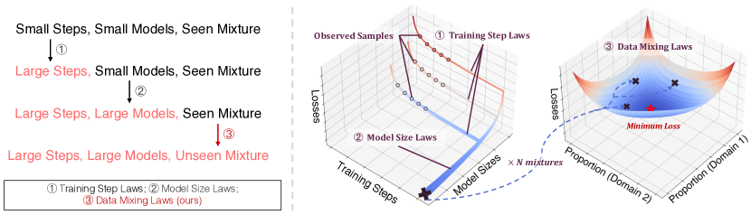

# Data Mixing Laws: Optimizing Data Mixtures by Predicting Language Modeling Performance

<!-- source-sha256: 71c42d6af6dca0a2b11e5d2899b54695a5514a0b08de1d4fe694aa96b9fa42aa -->

[简体中文](README.md)

> Core mixture prediction, not original RedPajama scale.

## Paper information

| Field | Details |
|---|---|
| Paper | [Paper or original source](https://arxiv.org/abs/2403.16952) |
| Institution | University of Cambridge / Shanghai AI Laboratory. |
| First public release | 2024-03-25 (arXiv v1) |
| Author code | [yegcjs/mixinglaws](https://github.com/yegcjs/mixinglaws). |
| Local adapter or method key | `data-mixing-laws` |
| Local reproduction code | [`src/auto_research/reproductions/data_mixing_laws/`](https://github.com/daiwk/auto-research/tree/main/src/auto_research/reproductions/data_mixing_laws/) |

## Paper method and evidence

Train small pilot mixtures, fit per-evaluation-domain mixing laws and search previously unseen mixtures.


<!-- paper-figure:start -->
### Original paper figure

[](https://ar5iv.labs.arxiv.org/html/2403.16952/assets/x1.png)

Figure shows pilot mixtures, fitting and search. From the [original paper](https://arxiv.org/abs/2403.16952); copyright remains with the authors.
<!-- paper-figure:end -->

### Core equation

$$
L_i(\mathbf p,N)=c_i+\sum_j a_{ij}p_j^{-\beta_{ij}}N^{-\gamma_i},\quad\mathbf p^*=\arg\min_{\Delta} \sum_iw_iL_i.
$$

### Reported results

The paper uses small-model curves to predict higher-budget RedPajama mixtures, outperforming manual and uniform mixes.

## Local reproduction

WikiText-2 plus public narrative, matched token/validation protocol, seed 42. Uniform vs learned validation loss **5.6729→5.4758 (-3.48%)**. Fit per-domain exponential laws to ten pilots and search unseen grid points. [Fixed metrics](metrics/public-seed42.json). Unigram proxy is not a multi-model RedPajama scaling curve.

```bash
auto-research reproduce --paper data-mixing-laws --dataset-dir data --seed 42
auto-research evolve --model micro-llm --dataset wikitext-2 --direction "Combine data-mixing-laws with installed paper operators" --generations 2 --population 4
```
