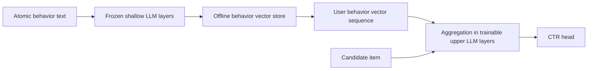
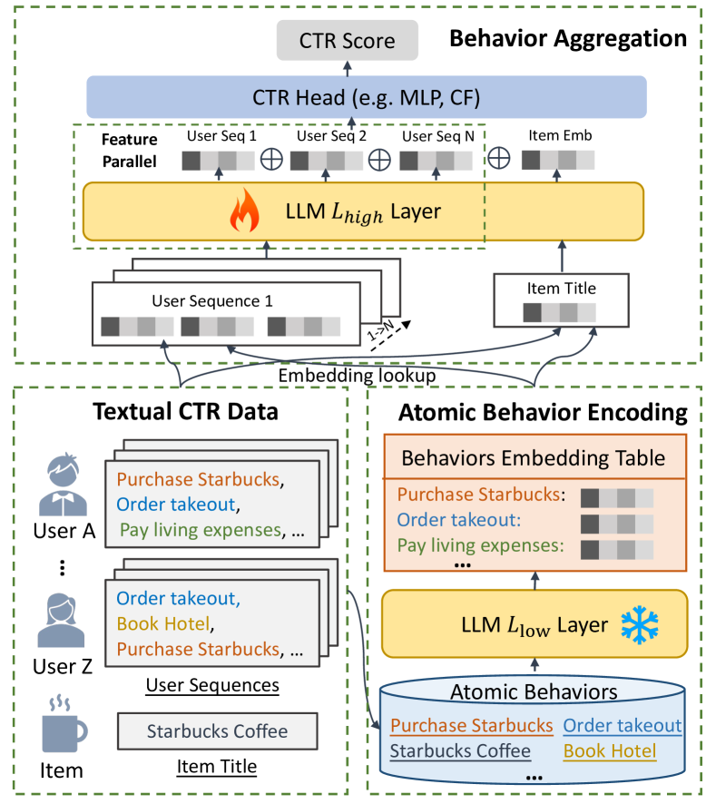

# BAHE: Hierarchical, cacheable encoding for long behavior text

<!-- source-sha256: a2ecf8a6abd102e4abb108ab165ade42c1d2e8d854307ccec2e0eff8071ad734 -->

[简体中文](README.md)

> **Fidelity: Full core pipeline.** The local run encodes and stores atomic behaviors with frozen shallow LLM layers, then trains upper Transformer layers for behavior aggregation and CTR. BERT-tiny and MovieLens-100K stand in for the production LLM and ad logs.

## Paper information

| Field | Value |
| --- | --- |
| Paper link | [arXiv 2403.19347](https://arxiv.org/abs/2403.19347) |
| Organization | Ant Group |
| First published | 2024-03-28 (arXiv v1) |
| Original author code | No official or author code was provided in the paper (checked 2026-08-09). |
| Adapter | `bahe` |
| Local reproduction code | [`src/auto_research/reproductions/bahe/`](https://github.com/daiwk/auto-research/tree/main/src/auto_research/reproductions/bahe/) |

## Original paper summary

### Background and main changes

Repeatedly passing long behavior text through an LLM re-encodes the same atomic behavior and tightly couples low-level semantics to higher-level interactions. BAHE encodes each atomic behavior in shallow layers and caches it offline. During training, deeper trainable layers aggregate cached vectors and predict CTR with the candidate item. The upper sequence is shorter and the shallow stage can update less frequently and asynchronously.



<!-- paper-figure:start -->
### Key figure from the paper

[](https://ar5iv.labs.arxiv.org/html/2403.19347/assets/x1.png)

**Original Figure 1 (architecture):** Main modules and their connections. Image from the [original paper](https://arxiv.org/abs/2403.19347); copyright belongs to the authors. Click the image for its source.
<!-- paper-figure:end -->

### Core equations

The shallow stage computes and caches each atomic representation once:

$$
b_j=F_p(\mathrm{LLM}_{1:k}(x_j)),\qquad b_j\rightarrow\text{offline DB}.
$$

Training fetches the sequence and uses upper layers for cross-behavior interactions:

$$
u=F_p(\mathrm{LLM}_{k+1:L}([b_1,\ldots,b_n,e_i])),\qquad
\hat y=\sigma(\mathrm{MLP}(u)).
$$

Compute moves from repeated processing of all tokens, $O(T^2L)$, to cached lower layers and upper-layer processing of $n$ behaviors, $O(n^2(L-k))$. Actual gain depends on the token-to-behavior compression and cache hit rate.

### Offline and online results in the paper

At text length 2048, LLM-CTR has AUC 0.7276, 928 GPU-h, and 75.4GB; BAHE has AUC 0.7309, **164 GPU-h**, and **12.6GB**. Downstream CTR $AUC_d$ is 0.7352 versus 0.7323 for the full-encoding control. In production, 8 A100s cut training on 50 million examples from 5 days to 1 day, enabling daily updates.

A two-week ads A/B test reports CTR **+9.65%** and CPM **+2.41%**. The business effect includes the freshness change from weekly to daily updates and is not just static network accuracy.

## Local reproduction

> **Control:** Per-example full-text upper-layer tuning versus atomic caching and hierarchical aggregation. Time changes **-53.61%**, but AUC changes **-2.94%**. This is an efficiency–quality trade-off, not an accuracy gain.

The first BERT-tiny layer encodes and caches individual MovieLens titles. Its copied upper layer processes [CLS], 12 historical behaviors, and the candidate. The control reruns frozen lower and trainable upper layers on the full text. Each of 3 seeds uses 5,000 training and 1,000 test examples with 80 steps.

| Method | AUC mean ± std | ms/example mean ± std |
|---|---:|---:|
| Full-text upper tuning | **0.59757 ± 0.00767** | 0.5651 ± 0.0572 |
| BAHE cached hierarchy | 0.58002 ± 0.01326 | **0.2622 ± 0.0565** |

End-to-end local per-example time decreases **53.61%**, but AUC decreases **2.94%**. The efficiency mechanism holds, not lossless quality. With only two layers, the small model offers much less separation between shallow and deep stages than the production model. See [metrics/movielens-100k-seeds42-44.json](metrics/movielens-100k-seeds42-44.json).

```bash
pip install -e '.[plum]'
for seed in 42 43 44; do
  AUTO_RESEARCH_BAHE_STEPS=80 AUTO_RESEARCH_BAHE_TRAIN=5000 \
  AUTO_RESEARCH_BAHE_TEST=1000 \
  auto-research reproduce --paper bahe --dataset-dir data --seed "$seed"
done
```

Atomic vectors, models, data, and checkpoints stay in Git-ignored directories. Only aggregate metrics are stored in the repository.
