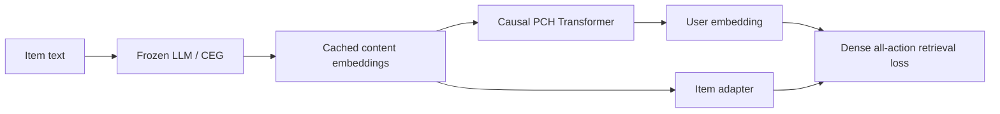
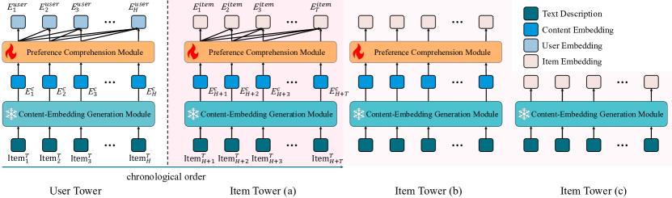

<!-- source-sha256: 999b6a2e3a6c9002c410b5cda3350fc5be44ea23d7176595911fed209859d568 -->

[简体中文](README.md) · English

# LEARN: Adapting frozen LLM content knowledge to the collaborative domain

> **Fidelity: full core pipeline.** Runs a frozen pretrained LM for CEG, cached item embeddings, causal PCH, dense all-position loss, and online projection. BERT-tiny and MovieLens replace Baichuan2-7B and Kuaishou logs.

## Paper information

| Field | Details |
| --- | --- |
| Paper | [arXiv 2405.03988](https://arxiv.org/abs/2405.03988) |
| Institution | Kuaishou |
| First public release | 2024-05-07 (arXiv v1) |
| Author code | No official or author-released code found in the paper (checked 2026-08-09). |
| Local adapter or method key | `learn` |
| Local reproduction code | [`src/auto_research/reproductions/learn/`](https://github.com/daiwk/auto-research/tree/main/src/auto_research/reproductions/learn/) |

## Original paper summary

### Background and main changes

Directly using frozen LLM embeddings for recommendation leaves a gap between open-world semantics and collaborative signals. LEARN's CEG freezes the LLM and mean-pools item text. PCH uses a trainable causal Transformer to learn user preferences from historical content embeddings, then projects them into the online recommendation space.



<!-- paper-figure:start -->
### Key figure from the paper

[](https://ar5iv.labs.arxiv.org/html/2405.03988/assets/x4.png)

> **Figure 3:** The core architecture, its main modules, and their connections. From the [paper](https://arxiv.org/abs/2405.03988); copyright belongs to the authors. Click for the source.
<!-- paper-figure:end -->

### Core equations

$$
e_i^c=\mathrm{meanpool}(LLM(text_i)),\quad
u_{1:H}=PCH(e_{i_1}^c,\ldots,e_{i_H}^c),\quad
\mathcal L=-\sum_t\log\frac{e^{u_t^\top v_{t+1}}}{\sum_j e^{u_t^\top v_j}}.
$$

### Offline and online results

The paper reports H@100 of 0.0701 for LEARN versus 0.0101 for the frozen conversational LLM baseline, and H@200 of 0.1874 on Amazon Books. In a 9-day A/B test on 20% of Kuaishou traffic, cold-start and long-tail item revenue rose **+8.77% and +4.63%**, respectively. Cold-start and long-tail user revenue rose +1.56% and +5.79%.

## Local reproduction

> **Local comparison:** LEARN CEG+PCH is compared with the frozen LLM semantic mean. NDCG@10 rises from 0.00487 to 0.01622 (**+233.10%**) while head share rises to 69.50%. This ablates the knowledge-adaptation module; it is not a comparison against DIN.

| Model | Hit@10 | NDCG@10 |
|---|---:|---:|
| Frozen LLM semantic mean | 0.01073 | 0.00487 |
| LEARN CEG + PCH | **0.02718 ± 0.00124** | **0.01622 ± 0.00276** |

Relative NDCG improvement is +233.10%, with gains on 3/3 seeds. However, head share rises from 2.06% to **69.50%**. The gain accompanies strong popularity bias and cannot be read directly as a cold-start improvement. See [`metrics/movielens-100k-seeds42-44.json`](metrics/movielens-100k-seeds42-44.json).

```bash
for seed in 42 43 44; do AUTO_RESEARCH_LEARN_STEPS=140 auto-research reproduce --paper learn --dataset-dir data --seed "$seed"; done
```
