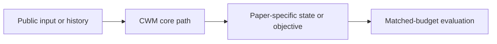
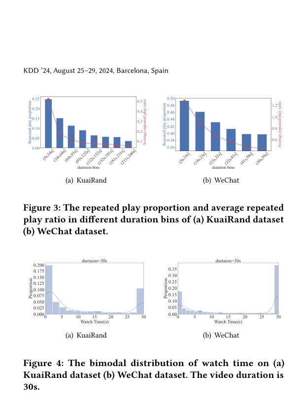

# Counteracting Duration Bias in Video Recommendation via Counterfactual Watch Time

<!-- source-sha256: 862b0557ad3702c0fb9195b5cd25e940e285ec0c02d7af4c5cf4381ff3c49104 -->

[简体中文](README.md)

> **Fidelity: core mechanism.** Paper results, public-data measurements, and omissions are reported separately.

## Paper information

| Field | Details |
|---|---|
| Paper | [arXiv 2406.07932](https://arxiv.org/abs/2406.07932) |
| Organization | Kuaishou Technology / Renmin University of China |
| First public release | 2024-06-12 (arXiv v1) |
| Authors' code | [Public implementation](https://github.com/hyz20/CWM) |
| Adapter / method | `cwm` |
| Local reproduction code | [`src/auto_research/reproductions/cwm/`](https://github.com/daiwk/auto-research/tree/main/src/auto_research/reproductions/cwm/) |

## Original paper

### Motivation and method

Use counterfactual watch-time estimation to remove video-duration bias, distinguishing observed watch time from potential utility under a common duration intervention.



<!-- paper-figure:start -->
### Key figure from the paper

[](https://arxiv.org/pdf/2406.07932#page=4)

> **Figure 4:** Overview of the paper's method and key components. From the [original paper](https://arxiv.org/abs/2406.07932); copyright remains with the authors.
<!-- paper-figure:end -->

### Core equations

$$
\hat y(d_0)=\mathbb E[Y\mid X,do(D=d_0)],\quad s=\hat y(d_0)-\lambda\,\operatorname{bias}(D).
$$

### Paper results

Kuaishou mean watch time +2.9%, video views +2.5%, and CTR +0.3%.

## Local reproduction

> **Local comparison:** The baseline is the shared transition + content scorer. Adding only the CWM core mechanism changes NDCG@10 by -17.89% relative.

MovieLens-100K, 260 users and 420 items, seed 42: NDCG@10 0.0354 → **0.0291 (-17.89%)**.

```bash
auto-research reproduce --paper cwm --dataset-dir data --seed 42
auto-research evolve --model rankmixer --dataset movielens-100k --direction "组合 cwm 与已安装论文算子" --generations 2 --population 4
```

See the [fixed metrics](metrics/public-seed42.json).

## Reproduction boundaries

Full-catalog MovieLens-100K exercises the paper's core state, objective, or inference path. No private features, production traffic, or online serving are used. Paper A/B results are cited separately and local numbers do not represent the original large model, data, traffic, or custom kernels.
