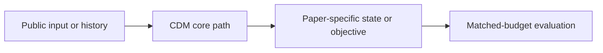
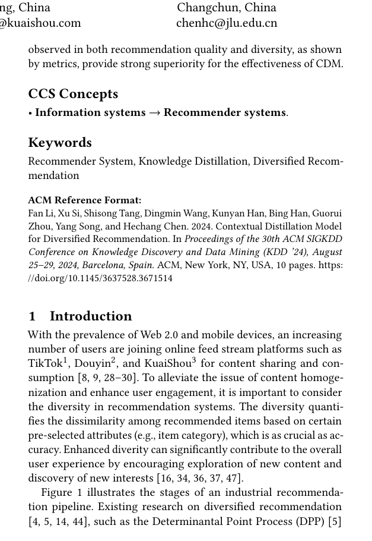

# Contextual Distillation Model for Diversified Recommendation

<!-- source-sha256: 884477285fff2fd44b4116d22b7b1acd5fc3c26e4b0581f580dfc31a066df185 -->

[简体中文](README.md)

> **Fidelity: core mechanism.** Paper results, local public-data measurements, and unreproduced parts are reported separately.

## Paper information

| Field | Details |
|---|---|
| Paper | [arXiv 2406.09021](https://arxiv.org/abs/2406.09021) |
| Organization | Kuaishou Technology |
| First public release | 2024-06-13 (arXiv v1) |
| Authors' code | The paper did not provide official or author code when checked on 2026-08-09. |
| Adapter / method | `cdm` |
| Local reproduction code | [`src/auto_research/reproductions/cdm/`](https://github.com/daiwk/auto-research/tree/main/src/auto_research/reproductions/cdm/) |

## Original paper

### Motivation and method

A controllable MMR teacher generates lists balancing relevance and diversity. Distill contextual marginal gains into a student suitable for low-latency serving.



<!-- paper-figure:start -->
### Key figure from the paper

[](https://arxiv.org/pdf/2406.09021#page=1)

> **Figure 1:** Overall workflow, stages, and data flow. From the [original paper](https://arxiv.org/abs/2406.09021); copyright remains with the authors.
<!-- paper-figure:end -->

### Core equations

$$
y_t=\arg\max_i[s(i)-\lambda\max_{j<t}\operatorname{sim}(i,j)],\quad\mathcal L=\|f_\theta-y_{teacher}\|^2.
$$

### Paper results

Kuaishou main-app watch time rises +0.406% and clustering coefficient falls -0.957%.

## Local reproduction

> **Local comparison:** The shared transition + content scorer is the baseline. Adding only the `cdm` core mechanism yields +1.25% relative NDCG@10.

MovieLens-100K, 260 users and 420 items, seed 42: NDCG@10 moves from 0.0354 to **0.0358 (+1.25%)** under the matched baseline and treatment.

```bash
auto-research reproduce --paper cdm --dataset-dir data --seed 42
auto-research evolve --model rankmixer --dataset movielens-100k --direction "组合 cdm 与已安装论文算子" --generations 2 --population 4
```

See the [fixed metrics](metrics/public-seed42.json).

## Reproduction boundaries

Full-catalog MovieLens-100K executes the core state, objective, or inference path. No private company features, production traffic, or online service is used. Paper A/B measurements are distinct from local results, which do not represent the original model scale, private data, traffic, or custom kernels.
