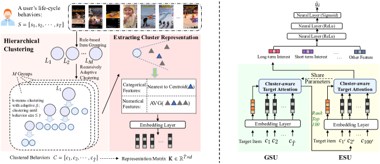

# TWIN V2: Scaling Ultra-Long User Behavior Sequence Modeling for Enhanced CTR Prediction at Kuaishou

<!-- source-sha256: 5aeb6be1772b4057b1b49a680a4bf8062e23a534a4d013bfc0480b24a0eab3cc -->

[简体中文](README.md)

> **Fidelity: core mechanism.** Paper conclusions, local public-data experiments, and omitted work are reported separately.

## Paper information

| Field | Details |
|---|---|
| Paper | [CIKM 2024](https://arxiv.org/abs/2407.16357) |
| Organization | Kuaishou |
| First public release | 2024-07-23 (arXiv v1) |
| Authors' code | The paper did not supply official or author code when checked on 2026-08-09. |
| Adapter / method | `twin-v2` |
| Local reproduction code | [`src/auto_research/reproductions/twin_v2/`](https://github.com/daiwk/auto-research/tree/main/src/auto_research/reproductions/twin_v2/) |

## Original paper

### Motivation and method

Offline hierarchical clustering compresses millions of lifetime behaviors into virtual items with cluster-size information. Online, GSU retrieves relevant clusters and ESU fine-ranks with cluster-aware target attention.


<!-- paper-figure:start -->
### Key figure from the paper

[](https://ar5iv.labs.arxiv.org/html/2407.16357/assets/x2.png)

> **Figure 2:** Overview of the paper's method and key components. From the [original paper](https://arxiv.org/abs/2407.16357); copyright remains with the authors.
<!-- paper-figure:end -->

### Core equations

$$
a_c=q^\top k_c-\tfrac12\log |c|,\quad h=\sum_{c\in\operatorname{TopK}(a)}\sum_{i\in c}\alpha_i v_i.
$$

### Paper results

Kuaishou reports watch time +0.672%/+0.800%/+0.728% across three scenarios, serving the main traffic of around 400 million DAU.

## Local reproduction

> **Local comparison:** The `shared transition + content baseline` and `TWIN-V2` treatment differ only in the core mechanism. `ndcg_at_10` rises from 0.0354 to **0.0433, or +22.45% relative**.

```bash
auto-research reproduce --paper twin-v2 --dataset-dir data --seed 42
```

See the [fixed metrics](metrics/public-seed42.json).

## Reproduction boundaries

Full-catalog MovieLens-100K ranking exercises paper-related candidate-aware retrieval, hierarchical compression, or distillation. No private logs or production serving are used; online A/B comes only from the paper and must remain separate from local relative changes.
