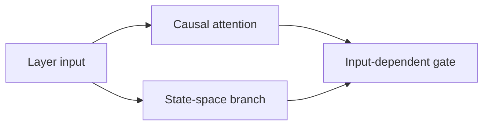
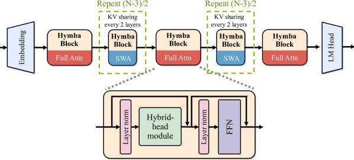

# Hymba: A Hybrid-head Architecture for Small Language Models

<!-- source-sha256: 1ab0fcf1bfed1b26d8abe5c5e099e466263874e393daadc04ce70eb688a31980 -->

[简体中文](README.md)

> Core hybrid-head mechanism; local and original results are separate.

## Paper information

| Field | Details |
|---|---|
| Paper | [arXiv 2411.13676](https://arxiv.org/abs/2411.13676) |
| Institution | NVIDIA. |
| First public release | 2024-11-20 (arXiv v1) |
| Author code | [NVlabs/hymba](https://github.com/NVlabs/hymba). |
| Local adapter or method key | `hymba` |
| Local reproduction code | [`src/auto_research/reproductions/hymba/`](https://github.com/daiwk/auto-research/tree/main/src/auto_research/reproductions/hymba/) |

## Paper method and evidence

Run attention and a state-space branch in parallel within one layer. An input-dependent gate combines exact local retrieval with linear long-range state.



<!-- paper-figure:start -->
### Original paper figure

[](https://ar5iv.labs.arxiv.org/html/2411.13676/assets/x5.png)

The original figure shows hybrid attention and state branches. From the [original paper](https://arxiv.org/abs/2411.13676); copyright remains with the authors.
<!-- paper-figure:end -->

### Core equation

$$
H'=H+g(X)\odot A(X)+(1-g(X))\odot SSM(X).
$$

### Reported results

Hymba-1.5B reports a better accuracy/cache/throughput tradeoff among similar-size models.

## Local reproduction

On WikiText-2 at 12 steps, 64 dimensions, two layers and seed 42, matched `llama_modern` → `hymba` PPL is **421.18 → 457.10 (+8.53%)**. Parameter, token, optimizer, and step budgets match.

```bash
auto-research reproduce --paper hymba --dataset-dir data --seed 42
auto-research evolve --model micro-llm --dataset wikitext-2 --direction "Combine hymba with installed paper operators" --generations 2 --population 4
```

[Fixed metrics](metrics/public-seed42.json). Actual causal attention and depthwise-convolution state branches are gated per layer. No 1.5B run, meta tokens, fused kernel, or paper-scale efficiency result.
