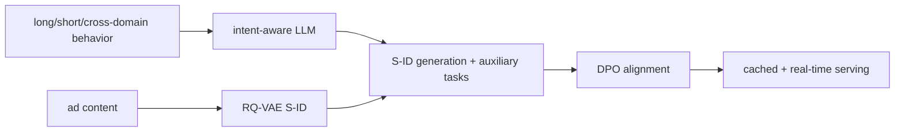
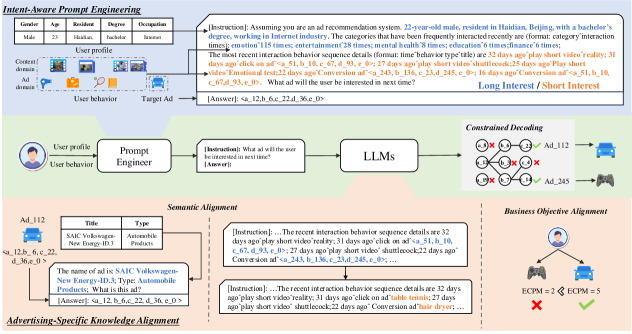

# LEADRE: LLM-based generative ad retrieval with multifaceted knowledge

<!-- source-sha256: f10d32704fce67b43325ba175f0538ad94c5ec0685733b2b56e6680bc037ae05 -->

[简体中文](README.md)

> **Fidelity: full core path.** Runs semantic IDs, long/short-term and commercial intent, semantic and value auxiliary tasks, SFT followed by DPO, and cached and real-time paths. Private ads and production serving are not reproduced.

## Paper information

| Field | Details |
|---|---|
| Paper | [arXiv 2411.13789](https://arxiv.org/abs/2411.13789) |
| Organization | Tencent / WeChat |
| First public release | 2024-11-21 (arXiv v1) |
| Authors' code | The paper did not provide official or author code when checked on 2026-08-09. |
| Adapter / method | `leadre` |
| Local reproduction code | [`src/auto_research/reproductions/leadre/`](https://github.com/daiwk/auto-research/tree/main/src/auto_research/reproductions/leadre/) |

## Original paper

### Motivation and method

ID retrieval struggles to use ad content. LEADRE builds intent-aware prompts from cross-domain behavior, long-term summaries, and real-time behavior. It quantizes ads to S-IDs, trains ad semantics and commercial-value auxiliary tasks, then aligns with DPO. Online serving combines a long-term generation cache with real-time serving.

<!-- paper-figure:start -->
### Key figure from the paper

> **Figure 2:** Core architecture, modules, and connections. From the [original paper](https://arxiv.org/abs/2411.13789); copyright remains with the authors.
<!-- paper-figure:end -->

### Core equations

SFT uses $L=L_{SID}+\lambda_sL_{semantic}+\lambda_vL_{value}$. DPO uses $-\log\sigma(\beta[(\log\pi_\theta(y_w)-\log\pi_\theta(y_l))-(\log\pi_{ref}(y_w)-\log\pi_{ref}(y_l))])$.

### Paper results

HR@1 is 0.0764 and NDCG@8 0.1360. WeChat Channels and Moments GMV increase **+1.57%/+1.17%**, respectively, and deployment serves tens of billions of requests daily.

## Local reproduction

> **Local comparison:** LEADRE is **+12.94%** relative to the shared DIN baseline on NDCG@10. Against the internal S-ID multitask SFT baseline, adding DPO changes NDCG by **-4.53%**. Report system and alignment ablations separately.

MovieLens-100K, 180 users, 280 items, seeds 42–44: DIN at 100 steps has Hit/NDCG 0.0481/0.02167, and LEADRE 0.0574/0.02447, or **+12.94%** relative NDCG. Internally, DPO changes SFT's 0.02563 to 0.02447 (**-4.53%**). The local gain comes from the full S-ID/SFT system, not DPO. See the [metrics](metrics/movielens-100k-seeds42-44.json).
