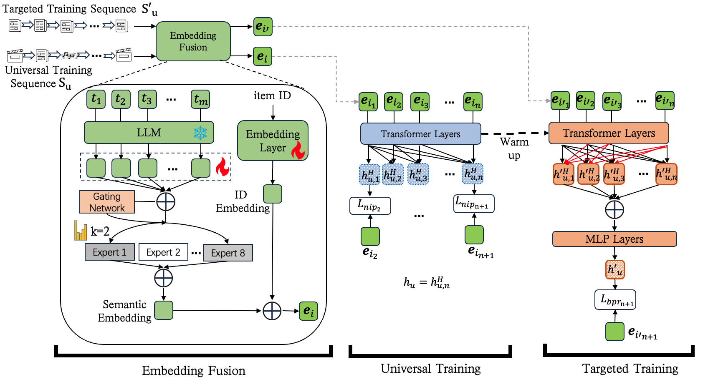

# PRECISE: Progressive Sequential Pretraining with LLM Semantics and Collaborative IDs

<!-- source-sha256: 7f6e217ceca5bfe51234ffd2175896e44678b1bcc1b33ebb202820f94690e6e7 -->

[简体中文](README.md)

> **Fidelity: full core pipeline.** The implementation executes LLM token hidden-state initialization, trainable tokens, top-k MoE attention, alternating ID/text training, all-scene causal NIP, a bidirectional target-scene Transformer, sequence concatenation and MLP, and cross-user BPR. Qwen2-1.5B is scaled down to SmolLM2-135M and private WeChat logs are replaced by MovieLens-1M.

## Paper information

| Field | Details |
|---|---|
| Paper | [arXiv 2412.06308](https://arxiv.org/abs/2412.06308) |
| Organization | Tencent / WeChat |
| First public release | 2024-12-09 (arXiv v1) |
| Authors' code | No official or author implementation is linked by the paper (checked 2026-08-09). |
| Adapter / method | `precise` |
| Local reproduction code | [`src/auto_research/reproductions/precise/`](https://github.com/daiwk/auto-research/tree/main/src/auto_research/reproductions/precise/) |

## Original paper

### Motivation and method

ID-only sequential models learn collaborative relationships but undertrain long-tail items. Text-only and LLM methods transfer semantics but can lose collaborative information. PRECISE fuses ID and text at the item level and separates Universal Training (UT), which models interests across scenes, from Targeted Training (TT), which adapts to a sparse target scene or task. To keep strong text representations from starving the ID pathway of learning signal, text tokens are initially frozen while IDs train, then unfrozen for joint training.


<!-- paper-figure:start -->
### Key figure from the paper

[](https://ar5iv.labs.arxiv.org/html/2412.06308/assets/figs/frameworknew.png)

> **Figure 2:** Core architecture, its modules, and their connections. From the [original paper](https://arxiv.org/abs/2412.06308); copyright remains with the authors.
<!-- paper-figure:end -->

### Core equations

The LLM produces tokens in source order. Every MoE expert pools the tokens with attention; the gate activates only the top-k experts:

$$
\mathbf x_i=LLM(T_i),\qquad gate(\mathbf x_i)=softmax(topk(\mathbf x_iW^{gate})),
$$

$$
\mathbf e_i=ID(i)\oplus\sum_{j=1}^{K}gate(\mathbf x_i)_j\,Attn_j(\mathbf x_i).
$$

UT uses a causal Transformer and sampled next-item softmax, drawing negatives from other sequences at each position:

$$
\mathcal L_{nip}=-\sum_{u,i}\log\frac{\exp(\mathbf h^H_{u,i}\cdot\mathbf e_{i+1})}{\exp(\mathbf h^H_{u,i}\cdot\mathbf e_{i+1})+\sum_{j\in N_u}\exp(\mathbf h^H_{u,i}\cdot\mathbf e_j)}.
$$

TT warm-starts from UT, removes the causal mask, and concatenates all positions before the MLP computes the user embedding:

$$
\mathbf h'_u=MLP(CONCAT(\mathbf h'^{H}_{u,1},\ldots,\mathbf h'^{H}_{u,n})),
$$

$$
\mathcal L_{bpr}=-\sum_u\sum_{u'\ne u}\log\sigma(\mathbf h'_u\cdot\mathbf e_{u,n+1}-\mathbf h'_{u'}\cdot\mathbf e_{u,n+1}).
$$

### Paper results

On Amazon Books, PRECISE-UT obtains R@10/N@10 **0.0439/0.0269** versus HLLM 0.0419/0.0227. On WeChat-AllScene it obtains **0.0197/0.0139** versus 0.0174/0.0125. WeChat cold-item R@10 is **0.0260**, about 14.5% above HLLM's 0.0227. Full PRECISE yields target Click R@10 **0.0158** (TT-only 0.0109) and Share R@10 **0.0055** (TT-only 0.0018).

Online ranking A/B on 180 million participants reports active users **+0.174%**, clicks **+1.961%**, shares **+1.433%**, and reading time **+0.884%**. In recall, Share-U2I peaks at **+2.560%** shares. The paper also describes daily user/item embedding generation, U2I/U2I2I ANN recall, and serving pretrained embeddings and dot-product scores through DCN.

## Local reproduction

> **Local comparison.** Target-only PRECISE-TT is the baseline; the experiment uses all-scene UT before TT. Recall@10 is **+40.00%** and NDCG@10 **+32.53%**, but cold Recall@10 is **-50.00%**. This ablates pretraining, not DIN.

MovieLens-1M ratings ≥3 form the all-scene positive sequence, and ratings ≥4 define the sparser target task. Each user's final high-rated item is held out and not seen in training. As in the paper, test items never seen in the training catalog are dropped. The final set has 290 users and 2,822 items. A real SmolLM2-135M encodes movie titles and genres into eight cached contextual token hidden states, which become trainable variables in the MoE and recommendation losses.

Two refinements fixed identical in-batch items being treated as mutually exclusive classes and raised TT from 80 to 240 steps. The final three-seed protocol uses 120 UT steps (tokens frozen for the first 60), then 240 TT steps:

| Method | Recall@10 mean ± std | NDCG@10 mean ± std | Cold Recall@10 |
|---|---:|---:|---:|
| PRECISE-TT only | 0.005747 ± 0.003251 | 0.003007 ± 0.002280 | **0.011594 ± 0.004099** |
| PRECISE UT + TT | **0.008046 ± 0.004301** | **0.003986 ± 0.001879** | 0.005797 ± 0.004099 |

UT+TT gives **+40.0%** relative Recall@10 and **+32.53%** NDCG@10. Recall increases for seeds 43/44 and ties for seed 42. Cold Recall drops **50.0%** and is low in absolute terms. The smaller public-data run supports the direction that all-scene training can mitigate sparse target signals, but does not reproduce long-tail gains or establish online WeChat effect sizes. UT losses across the seeds decline from 6.661/6.615/6.613 to 5.818/5.858/5.824.

```bash
pip install -e '.[plum]'
for seed in 42 43 44; do
  AUTO_RESEARCH_PRECISE_USERS=300 \
  AUTO_RESEARCH_PRECISE_UT_STEPS=120 \
  AUTO_RESEARCH_PRECISE_TT_STEPS=240 \
  auto-research reproduce --paper precise --dataset-dir data --seed "$seed"
done
```

The LLM token cache is in `data/precise/`. Initial generation takes roughly five seconds and later runs reuse it. Data, caches, run outputs, and checkpoints are not committed. See [stable metrics](metrics/movielens-1m-seeds42-44.json).
