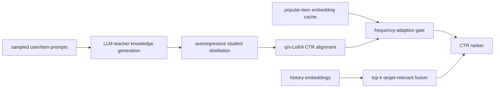
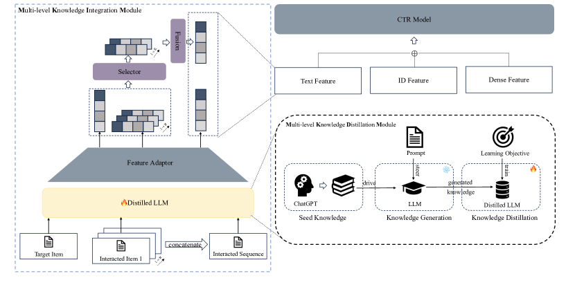

# MSD: Distilling LLM knowledge into an alignable, cacheable CTR model

<!-- source-sha256: 77d47b7a177ffda0ce09e9a38ada5ceb82db8365ef539633a09bd87965be44a0 -->

[简体中文](README.md)

> **Fidelity: Full core pipeline.** The local run executes teacher knowledge generation, autoregressive T5 distillation, q/v-LoRA CTR alignment, multilevel adapters, frequency-adaptive caching and online computation, and relevant-history fusion. Production ad features and cache services are not reproduced.

## Paper information

| Field | Value |
| --- | --- |
| Paper link | [arXiv 2412.06860](https://arxiv.org/abs/2412.06860) |
| Organization | Meituan |
| First published | 2024-12-09 (arXiv v1) |
| Original author code | No official or author code was provided in the paper (checked 2026-08-09). |
| Adapter | `msd` |
| Local reproduction code | [`src/auto_research/reproductions/msd/`](https://github.com/daiwk/auto-research/tree/main/src/auto_research/reproductions/msd/) |

## Original paper summary

### Background and main changes

Calling a large model directly in CTR ranking is effective but too expensive, while a static embedding cache cannot adapt to the CTR objective. MSD's MKDM uses a large teacher to generate keywords and reasoning for users and items, then a smaller student learns those outputs autoregressively. MKIM aligns the distilled student to CTR with LoRA and combines user, target, and history features through adapters. Popular items use precomputed embeddings, low-frequency items and cache misses are encoded online, and fusion uses only the history most relevant to the target.



<!-- paper-figure:start -->
### Key figure from the paper

[](https://ar5iv.labs.arxiv.org/html/2412.06860/assets/x2.png)

**Original Figure 2 (architecture):** Main modules and their connections. Image from the [original paper](https://arxiv.org/abs/2412.06860); copyright belongs to the authors. Click the image for its source.
<!-- paper-figure:end -->

### Core equations

Distillation trains the student on teacher-generated token sequences:

$$
\mathcal L_{KD}=-\sum_t\log p_{S}(y_t^{T}\mid x,y_{<t}^{T}).
$$

CTR alignment freezes the backbone and learns low-rank updates:

$$
W'=W+\frac{\alpha}{r}BA.
$$

The frequency gate chooses cached or online LoRA embeddings and fuses the top-k relevant history:

$$
e_i=m(f_i)e_i^{cache}+[1-m(f_i)]e_i^{online},\qquad
\tilde e_i=e_i+\operatorname{Adapter}\left(\operatorname{Mean}(\operatorname{TopK}_{h\in H}\operatorname{sim}(e_i,e_h))\right).
$$

### Offline and online results in the paper

KDD Cup 2012 AUC: 0.7763 for DeepFM, 0.7846 for PRINT, and **0.7871** for MSD. On Meituan's private data, DeepFM reaches 0.6938 versus **0.7087** for MSD. Removing LoRA, item fusion, or user knowledge yields 0.7075, 0.7069, or 0.7054 respectively.

Meituan search ads A/B, 2024-10-20 to 10-30: CTR **+2.12%**, CPM **+2.59%**. The paper reports 35ms for the baseline and 37.2ms for MSD.

## Local reproduction

> **Control:** ID-only CTR ranker versus full MSD. AUC rises from 0.68449 to 0.69510 (**+1.55%**). This ablates LLM distillation and cached semantic features jointly, not MSD against DIN.

MovieLens-100K titles, genres, and time-ordered interactions define a CTR task. The SmolLM2-135M-Instruct teacher generates knowledge for 30 users and 160 frequency-stratified items. T5-small distills autoregressively for 32 steps. The frozen student then gets **147,456** q/v-LoRA parameters and 100 steps of CTR alignment. Popular items use cached embeddings; low-frequency items retain the online LoRA path. The history contributes the top-3 items by semantic similarity to the target.

| Method | AUC mean ± std | train+eval seconds mean |
|---|---:|---:|
| ID CTR | 0.684486 ± 0.005765 | **about 1.1** |
| MSD | **0.695098 ± 0.024651** | about 22.0 |

Mean relative AUC lift is **+1.55%**, positive for 2/3 seeds but negative for seed 44, so it is not stable. Distillation losses fall from 2.40/2.38/2.36 to 1.55/1.13/1.17, confirming actual teacher-to-student training. Local times do not reproduce production efficiency: the run retains the frequency gate and cache semantics but not Meituan's asynchronous batching or online embedding service. See [metrics/movielens-100k-seeds42-44.json](metrics/movielens-100k-seeds42-44.json).

```bash
pip install -e '.[plum]'
for seed in 42 43 44; do
  AUTO_RESEARCH_MSD_USERS=30 AUTO_RESEARCH_MSD_TEACHER_ITEMS=160 \
  AUTO_RESEARCH_MSD_DISTILL_STEPS=32 AUTO_RESEARCH_MSD_STEPS=100 \
  auto-research reproduce --paper msd --dataset-dir data --seed "$seed"
done
```

Teacher text, student checkpoints, cached embeddings, and raw runs stay in Git-ignored directories. Only aggregate metrics are committed.
