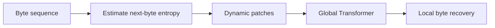
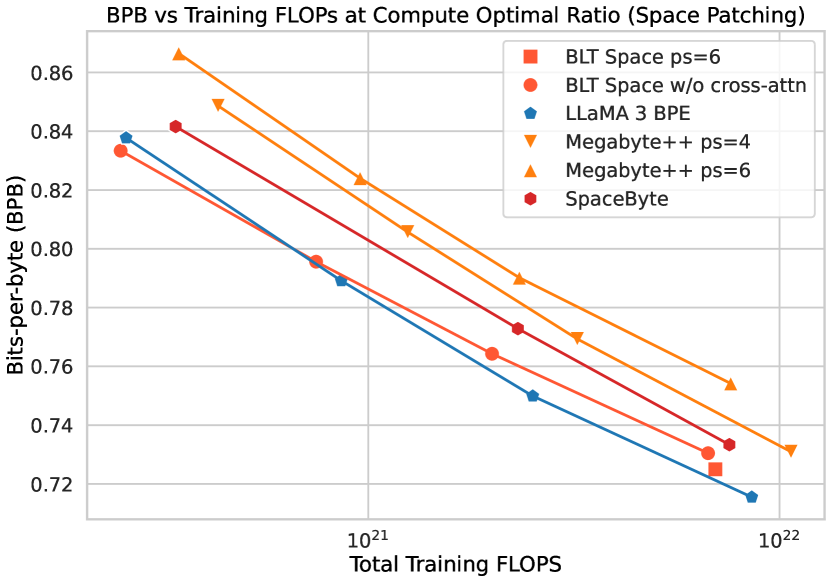

# Byte Latent Transformer: Patches Scale Better Than Tokens

<!-- source-sha256: 346faee909fdd23b0fbaf33b6d4941c5dded7761384b5cff547e3d9ce76de256 -->

[简体中文](README.md)

> Core patch mechanism on public data, not the 8B model.

## Paper information

| Field | Details |
|---|---|
| Paper | [arXiv 2412.09871](https://arxiv.org/abs/2412.09871) |
| Institution | Meta FAIR. |
| First public release | 2024-12-13 (arXiv v1) |
| Author code | [facebookresearch/blt](https://github.com/facebookresearch/blt). |
| Local adapter or method key | `blt` |
| Local reproduction code | [`src/auto_research/reproductions/blt/`](https://github.com/daiwk/auto-research/tree/main/src/auto_research/reproductions/blt/) |

## Paper method and evidence

Process bytes directly, segmenting dynamic patches by next-byte entropy. The global Transformer operates on patches, while local encoders and decoders recover bytes.



<!-- paper-figure:start -->
### Original paper figure

[](https://ar5iv.labs.arxiv.org/html/2412.09871/assets/x6.png)

The original figure shows entropy-based patching. From the [original paper](https://arxiv.org/abs/2412.09871); copyright remains with the authors.
<!-- paper-figure:end -->

### Core equation

$$
b_t=\mathbf1[H(x_{t+1}|x_{\le t})>\tau],\quad z_k=E(x_{s_k:e_k}),\quad p(x)=D(T(z),x_{<t}).
$$

### Reported results

The authors report better scaling at fixed FLOPs and stronger robustness to noise and language variation.

## Local reproduction

WikiText-2, 12 steps, 64d/two layers, seed 42, matched `llama_modern`: PPL **421.18→412.21 (-2.13%)** with the same parameters, tokens, optimizer and steps. Learn surprisal boundaries, share latents across nearby low-entropy positions and expand back to targets. A 512-symbol tokenizer only approximates bytes; no full local encoders/decoders or original-scale claim.

```bash
auto-research reproduce --paper blt --dataset-dir data --seed 42
auto-research evolve --model micro-llm --dataset wikitext-2 --direction "Combine blt with installed paper operators" --generations 2 --population 4
```

[Fixed metrics](metrics/public-seed42.json).
