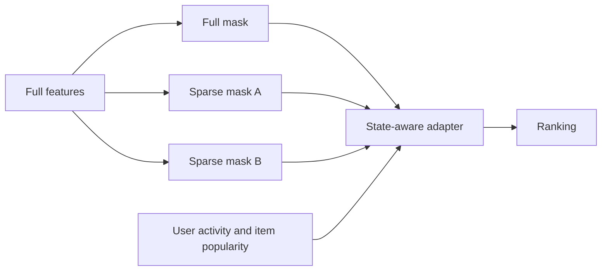
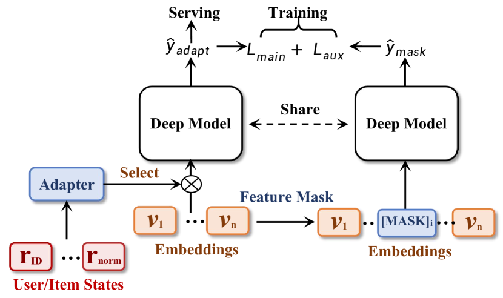

# AdaF²M²: multi-forward feature learning and state adaptation

<!-- source-sha256: 2d991784e26c11b977e0aa4f831dde83416c56e8a10597fbeef5eb8655249caa -->

[简体中文](README.md)

> **Fidelity: core mechanism.** Runs three feature-mask forwards, shared aggregation, and an adaptive user/item-state adapter.

## Paper information

| Field | Details |
|---|---|
| Paper | [arXiv 2501.15816](https://arxiv.org/abs/2501.15816) |
| Organization | ByteDance / Douyin |
| First public release | 2025-01-27 (arXiv v1) |
| Authors' code | The paper did not supply official or author code when checked on 2026-08-09. |
| Adapter / method | `adaf2m2` |
| Local reproduction code | [`src/auto_research/reproductions/adaf2m2/`](https://github.com/daiwk/auto-research/tree/main/src/auto_research/reproductions/adaf2m2/) |

## Original paper

### Motivation and method

A single all-feature forward can over-rely on strong features, and different user or item states need different features. AdaF²M² uses repeated forwards under distinct masks to learn complementary representations and fuses them dynamically with a state-aware adapter.



<!-- paper-figure:start -->
### Key figure from the paper

[](https://ar5iv.labs.arxiv.org/html/2501.15816/assets/x1.png)

> **Figure 1:** Core architecture, modules, and their connections. From the [original paper](https://arxiv.org/abs/2501.15816); copyright remains with the authors.
<!-- paper-figure:end -->

### Core equations

$$
h_k=f(x\odot m_k),\qquad
h=\sum_k \alpha_k(s)h_k,\quad
\alpha(s)=\operatorname{softmax}(W_s s).
$$

### Paper results

Private offline scenarios show gains from masked multi-forward and the adapter. Online Douyin cumulative active days rose `+1.37%` and app time `+1.89%`; the method was deployed for retrieval, ranking, and cold start.

## Local reproduction

> **Local comparison:** NDCG@10 is `+2.42%` relative to a single-forward full-feature baseline.

Compared with that baseline, NDCG@10 moves `0.07514→0.07696` (`+2.42%`), and head share moves `0.21762→0.15976`. See the [metrics](metrics/movielens-1m-seed42.json).

```bash
auto-research reproduce --paper adaf2m2 --dataset-dir data --seed 42
```

## Reproduction boundaries

States use only history length and item popularity. There are no private Douyin features, full-pipeline joint training, or online resource-cost measurements.
