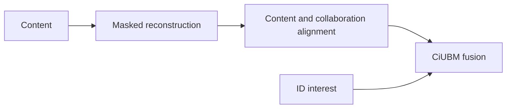
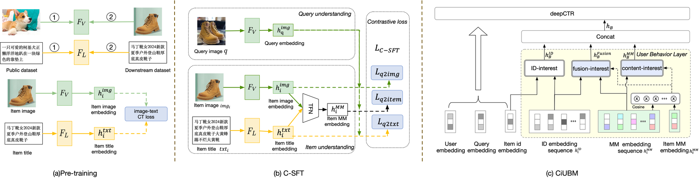

# MIM: Multimodal Content-Interest Modeling

<!-- source-sha256: 8641ac4e75356a8a46f7a44f44a74d7a20aede7fde83c75739fc83b53d7d4380 -->

[简体中文](README.md)

> **Core mechanism evidence.** Paper and local evaluations are separate.

## Paper information

| Field | Value |
| --- | --- |
| Paper | [arXiv 2502.00321](https://arxiv.org/abs/2502.00321) |
| Affiliations | Alibaba / Taobao |
| First public release | 2025-02-01 (arXiv v1) |
| Authors' code | [Authors' release](https://pan.quark.cn/s/8fc8ec3e74f3). |
| Adapter / method | `mim` |
| Local code | [`src/auto_research/reproductions/mim/`](https://github.com/daiwk/auto-research/tree/main/src/auto_research/reproductions/mim/) |

## Original paper

### Background and contribution

ID-only models struggle with fresh content. Reconstruct masked multimodal input, align content and collaborative interests with SFT, and fuse content/ID interests with CiUBM.



<!-- paper-figure:start -->
### Key figure from the paper

[](https://ar5iv.labs.arxiv.org/html/2502.00321/assets/imgs/T1-Par_framework3.png)

Original Figure 2: MIM. From the [paper](https://arxiv.org/abs/2502.00321); copyright belongs to the authors. Not a local result.
<!-- paper-figure:end -->

### Core mechanism

$$
\mathcal L=\mathcal L_{\mathrm{mask}}+\lambda\mathcal L_{\mathrm{align}}+
\mathcal L_{\mathrm{rank}},\qquad
s(u,i)=g(i_u^{ID},i_u^{content})^\top e_i .
$$

### Paper results

Private Taobao offline MIM/CiUBM beat ID/content baselines; tables do not support one pooled lift. Live CTR +14.14%, RPM +4.12%.

## Local reproduction

MovieLens-1M, 420 users/640 items, leave-two-out, full catalog. Against ID co-occurrence: Hit@10 0.14048→0.12143, NDCG@10 0.07514→0.07584 (+0.94%), MRR@10 0.05541→0.06228. [Metrics](metrics/movielens-1m-seed42.json).

```bash
auto-research reproduce --paper mim --dataset-dir data --seed 42
```

## Reproduction limits

Genres proxy image/text. No private impressions, actual multimodal encoder, or serving. Do not compare directly with live effects.
