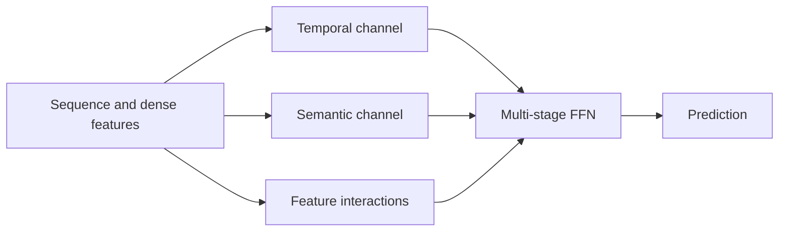
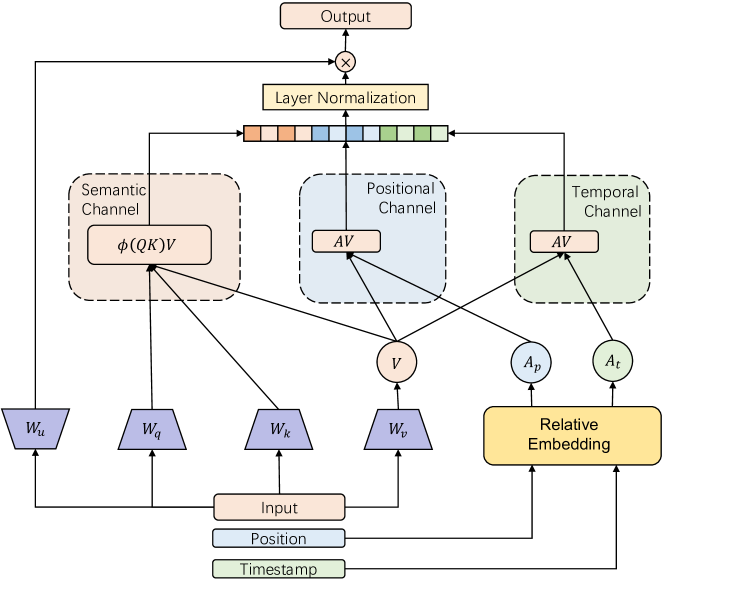

# FuXi-α: Feature-Interaction Enhanced Transformer

<!-- source-sha256: a6ce722df64116c75fb8dca11aefd7defe8a889f799bf0418a6ac01364ea828a -->

[简体中文](README.md)

> **Local core-mechanism evidence.** Paper outcomes and local results are separate.

## Paper information

| Field | Value |
| --- | --- |
| Paper | [arXiv 2502.03036](https://arxiv.org/abs/2502.03036) |
| Affiliations | Huawei / USTC |
| First public release | 2025-02-05 (arXiv v1) |
| Authors' code | [Authors' code](https://github.com/USTC-StarTeam/FuXi-alpha). |
| Adapter / method | `fuxi-alpha` |
| Local code | [`src/auto_research/reproductions/fuxi_alpha/`](https://github.com/daiwk/auto-research/tree/main/src/auto_research/reproductions/fuxi_alpha/) |

## Original paper

### Background and contribution

Scaling a recommendation Transformer can bottleneck on shallow feature interactions. Use adaptive temporal, semantic, and popularity channels with staged FFN fusion.



<!-- paper-figure:start -->
### Key figure from the paper

[](https://ar5iv.labs.arxiv.org/html/2502.03036/assets/x3.png)

Original Figure 3: FuXi-α. From the [paper](https://arxiv.org/abs/2502.03036); copyright belongs to the authors. Not a local result.
<!-- paper-figure:end -->

### Core mechanism

$$
H_c=\operatorname{softmax}(Q_cK_c^\top/\sqrt d)V_c,\qquad
H^{l+1}=H^l+\operatorname{FFN}_l([H^l,H_1,H_2,H_3]).
$$

### Paper results

The paper reports scaling gains on MovieLens-1M, KuaiRand, and industrial data. A seven-day 30%-traffic trial reports +4.67% songs played and +5.10% listening time.

## Local reproduction

Compared with one-channel attention, NDCG@10 0.07514→0.07194 (−4.25%), Hit@10 0.14048→0.14286. Keep the ranking regression. [Metrics](metrics/movielens-1m-seed42.json).

```bash
auto-research reproduce --paper fuxi-alpha --dataset-dir data --seed 42
```

## Reproduction limits

Small numeric implementation, not billion-scale training, private Huawei Music features, or distributed execution.
