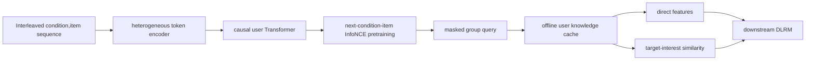
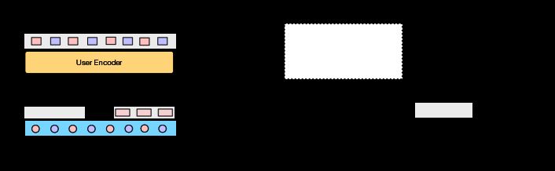

# LUM: Generative user knowledge and conditional queries for discriminative recommendation

<!-- source-sha256: edebdcf24f9d8cd085d6eb35242959a1098cb6d1136de3b8f2c26932afb7abba -->

[简体中文](README.md)

> **Fidelity: Full core pipeline.** The local run executes the heterogeneous condition/item encoder, causal next-condition-item InfoNCE, masked group queries, offline knowledge caching, direct features, interest matching, and downstream CTR DLRM. It does not reproduce the 7B scaling law.

## Paper information

| Field | Value |
| --- | --- |
| Paper link | [arXiv 2502.08309](https://arxiv.org/abs/2502.08309) |
| Organization | Alibaba |
| First published | 2025-02-12 (arXiv v1) |
| Original author code | No official or author code was provided in the paper (checked 2026-08-09). |
| Adapter | `lum` |
| Local reproduction code | [`src/auto_research/reproductions/lum/`](https://github.com/daiwk/auto-research/tree/main/src/auto_research/reproductions/lum/) |

## Original paper summary

### Background and main changes

End-to-end generative recommendation scales Transformer parameters but is difficult to fit around established online DLRMs, complex features, and millisecond latency. LUM learns user knowledge through a generative task, queries different interests offline with condition tokens, and passes fixed knowledge features to any discriminative DLRM. In `<condition, item>`, the condition describes the scene, search term, or category of the item being predicted. It is not an action attached afterward to the previous item.



<!-- paper-figure:start -->
### Key figure from the paper

[](https://ar5iv.labs.arxiv.org/html/2502.08309/assets/x3.png)

**Original Figure 3 (architecture):** Main modules and their connections. Image from the [original paper](https://arxiv.org/abs/2502.08309); copyright belongs to the authors. Click the image for its source.
<!-- paper-figure:end -->

### Core equations

Project features separately for each heterogeneous token type:

$$
e^t=\operatorname{proj}^t(\operatorname{concat}(f_1^t,f_2^t,\ldots)),\quad t\in\{c,i\}.
$$

Only condition outputs predict the immediately following item:

$$
p(c_1,i_1,\ldots,c_L,i_L)=\prod_{l=1}^{L}p(i_l\mid c_1,i_1,\ldots,i_{l-1},c_l),
$$

$$
\mathcal L=-\sum_l\log\frac{\exp(\operatorname{sim}(o_l^c,e_l^i))}{\exp(\operatorname{sim}(o_l^c,e_l^i))+\sum_k\exp(\operatorname{sim}(o_l^c,e_k^i))}.
$$

Step 2 appends multiple query conditions to a common history prefix, masking query-to-query attention. Step 3 uses knowledge vectors and target-matching scores together:

$$
\hat y=f\left(u,i,\{o_{q_n}^i,\operatorname{sim}(o_{q_n}^i,e_i^i)\}_{n=1}^{N},e_i^i\right).
$$

### Offline and online results in the paper

On public data, MovieLens-1M AUC is **0.7615** for LUM versus 0.7579 for SIM and 0.7533 for HSTU. LUM reaches **0.7483** on ML-20M and **0.6727** on Amazon Books. Industrial ranking AUC rises from 0.7338 for the production model to 0.7514, a gain of 0.0176. R@10/R@50 rise by 0.0133/0.0134.

Packing reduces Step 1 from 151h to 26h (-82%). Group queries reduce Step 2 from 17h to 3.6h (-78%). Taobao sponsored-search A/B reports CTR **+2.9%** and RPM **+1.2%**.

## Local reproduction

> **Control:** ID-DLRM versus the same downstream DLRM with offline LUM knowledge. AUC rises from 0.58233 to 0.66734 (**+14.60%**). This ablates LUM knowledge features, not DIN.

The local run uses the paper's MovieLens-1M dataset. Ratings are discretized into three actual conditions—low, medium, and high—placed strictly before the corresponding item. Item tokens combine IDs and official genres. 1,000 users yield 121,734 pretraining examples without test leakage. Step 1 trains for 200 steps. Step 2 queries all three conditions at once per example using a query block mask to share the history prefix. Step 3 caches knowledge and trains ID-DLRM or LUM-enhanced DLRM for 160 steps.

| Method | AUC mean ± std |
|---|---:|
| ID-DLRM | 0.582330 ± 0.017945 |
| LUM + DLRM | **0.667337 ± 0.007308** |

Relative AUC lift is **+14.60%**, positive for 3/3 seeds. Step 1 loss falls from 4.624/4.617/4.646 to 4.411/4.391/4.402. The large lift is against a lightweight ID-DLRM without sequence features; LUM adds fixed user knowledge, item knowledge, and three similarity features at once. This validates the three-step knowledge use locally, not a 7B scaling law. See [metrics/movielens-1m-seeds42-44.json](metrics/movielens-1m-seeds42-44.json).

```bash
pip install -e '.[neural-recs]'
for seed in 42 43 44; do
  AUTO_RESEARCH_LUM_USERS=1000 AUTO_RESEARCH_LUM_PRETRAIN_STEPS=200 \
  AUTO_RESEARCH_LUM_STEPS=160 AUTO_RESEARCH_LUM_TRAIN=6000 \
  AUTO_RESEARCH_LUM_TEST=1500 \
  auto-research reproduce --paper lum --dataset-dir data --seed "$seed"
done
```

Data, per-run outputs, cached knowledge, and checkpoints are not committed.
