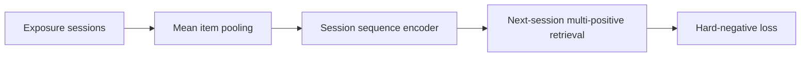
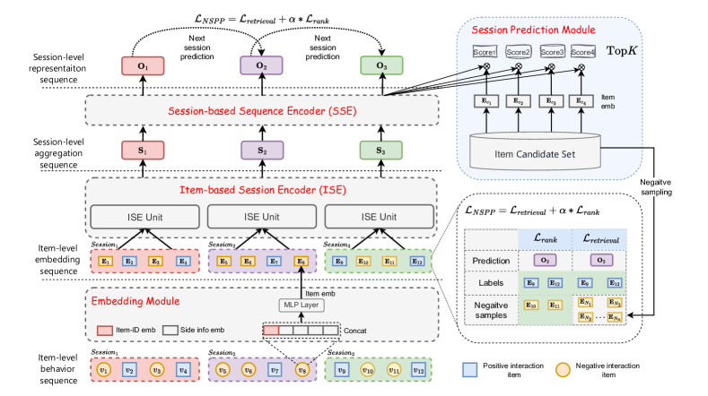

# SessionRec: Predict the next session instead of the next item

<!-- source-sha256: 9a594a2318841b676a86213f8bfb32ac3e8e3456d41e996646df24b99d27743e -->

[简体中文](README.md)

> **Fidelity: core mechanism reproduction.** Runs within-session pooling, a cross-session Transformer, multi-positive retrieval and same-session hard negatives. Private features and ANN serving are not reproduced.

## Paper information

| Field | Details |
|---|---|
| Paper | [Paper or original source](https://arxiv.org/abs/2502.10157) |
| Institution | Meituan |
| First public release | 2025-02-14 (arXiv v1) |
| Author code | No official author code identified (checked 2026-08-09). |
| Local adapter or method key | `sessionrec` |
| Local reproduction code | [`src/auto_research/reproductions/sessionrec/`](https://github.com/daiwk/auto-research/tree/main/src/auto_research/reproductions/sessionrec/) |

## Paper method and evidence

Item-by-item training forces an order onto a single consumption intent. SessionRec uses an item-based session encoder (ISE) to pool a visit into a token, then a session-based sequence encoder (SSE) to learn changes across visits. One query retrieves every positive from the next session. Mean pooling beats other paper ISE variants; SSE can be Transformer or HSTU. The negative loss uses genuine next-session exposures without positive feedback.



<!-- paper-figure:start -->
### Original paper figure

[](https://ar5iv.labs.arxiv.org/html/2502.10157/assets/x2.png)

Figure 2 shows the architecture and how its modules connect. From the [original paper](https://arxiv.org/abs/2502.10157); copyright remains with the authors.
<!-- paper-figure:end -->

### Core equation

$$
s_t=\frac{1}{|S_t|}\sum_{i\in S_t}e_i,\qquad
q_t=\operatorname{SSE}(s_1,\ldots,s_t)_{t}.
$$

$$
\mathcal L=\mathcal L_{multi\text{-}positive\ retrieval}
+\alpha\frac{1}{|P||N|}\sum_{p\in P,n\in N}\log(1+e^{q^\top e_n-q^\top e_p}).
$$

$P_{t+1}$ contains every next-session positive and $N_{t+1}$ the next-session unengaged exposures.

### Reported results

In KuaiSAR leave-one-session-out testing, SessionRec-HSTU Recall@500/NDCG@500 is 0.3318/0.1287, vs 0.2009/0.0701 for HSTU and 0.2212/0.0785 for HSTU+. A seven-day Meituan homepage A/B replacing SASRec reports Pay PV +0.603% and PVCTCVR +0.564%.

## Local reproduction

KuaiRand-Pure standard-traffic exposures are sessionized at 30 minutes. `is_click=1` or `long_view=1` is positive; other same-session exposures are hard negatives. Each user's last two valid sessions are validation/test. Dimension, layers, steps and sampling match the flat item Transformer. Training cycles through individual positive CE targets and evaluation retains all positives. MovieLens lacks session/exposure information, and DIN is not a baseline here. Seed-42 validation searches $\alpha\in\{0,0.01,0.1\}$; 0 and 0.01 tie at NDCG@20 0.002856, so 0.01 retains the hard-negative objective without selecting on test.

| Method | Recall@20 mean ± SD | NDCG@20 mean ± SD | Train + eval seconds |
|---|---:|---:|---:|
| Item Transformer | 0.011894 ± 0.002272 | 0.004718 ± 0.000924 | 11.32 |
| SessionRec Transformer | 0.009302 ± 0.001201 | 0.003678 ± 0.000640 | 10.53 |

NDCG@20 drops 22.05% with only 1/3 seeds improving, so the paper's gain is not reproduced. Few usable sessions per user, mixed interests within short-video sessions and lost order through mean pooling are plausible explanations, not demonstrated causes. [Stable metrics](metrics/kuairand-pure-seeds42-44.json). Archives, extracted data, runs and checkpoints remain ignored.

```bash
pip install -e '.[neural-recs]'
for seed in 42 43 44; do
  AUTO_RESEARCH_SESSIONREC_ROWS=350000 \
  AUTO_RESEARCH_SESSIONREC_USERS=2000 \
  AUTO_RESEARCH_SESSIONREC_STEPS=180 \
  auto-research reproduce --paper sessionrec --dataset-dir data --seed "$seed"
done
```
