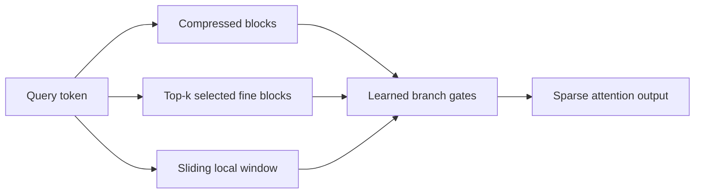
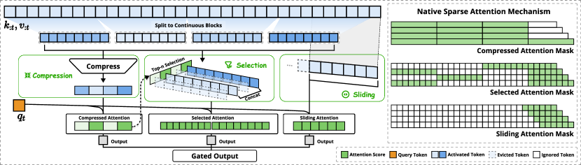

<!-- source-sha256: 898c268fd242c42d04b47376fd00675e99ad1541453a57d858333c59c2e3e963 -->

[简体中文](README.md) · English

# Native Sparse Attention: Trainable three-branch sparse attention

> **Fidelity: core-mechanism reproduction.** Trains compression, selection, and sliding-window attention branches. The Triton kernel and 27B training are not reproduced.

## Paper information

| Field | Details |
| --- | --- |
| Paper | [arXiv 2502.11089](https://arxiv.org/abs/2502.11089) |
| Institution | DeepSeek |
| First public release | 2025-02-16 (arXiv v1) |
| Author code | No official or author-released code found in the paper (checked 2026-08-09). |
| Local adapter or method key | `native-sparse-attention` |
| Local reproduction code | [`src/auto_research/reproductions/native_sparse_attention/`](https://github.com/daiwk/auto-research/tree/main/src/auto_research/reproductions/native_sparse_attention/) |

## Original paper summary

### Background and main changes

Full attention compute and KV reads grow quadratically with context length. NSA does not prune after training. From pretraining onward it learns three parallel paths: compressed history blocks for global structure, query-dependent block selection for important detail, and a sliding window for recent precise information. Learned gates blend the three outputs.



<!-- paper-figure:start -->
### Key figure from the paper

[](https://ar5iv.labs.arxiv.org/html/2502.11089/assets/x2.png)

> **Figure 2:** The core architecture, its main modules, and their connections. From the [paper](https://arxiv.org/abs/2502.11089); copyright belongs to the authors. Click for the source.
<!-- paper-figure:end -->

### Core equations

$$
o_t=\sum_{b\in\{\mathrm{cmp},\mathrm{sel},\mathrm{win}\}}
g_{t,b}\operatorname{Attn}_b(q_t,K_b,V_b),\qquad
g_t=\operatorname{softmax}(W_g h_t).
$$

Compression aggregates historical blocks. Selection picks top-$k$ blocks by similarity between $q_t$ and compressed keys. The sliding branch reads only $[t-w+1,t]$. All three branches remain causal.

### Offline and online results

The paper matches or exceeds full attention on general, long-context, and instruction reasoning benchmarks and reports substantial decoding, forward, and backward speedups at 64K. Standalone LLM work is not subject to the online A/B gate. The local PyTorch reference kernel does not reproduce hardware throughput.

## Local reproduction

> **Local comparison:** The `llama_modern` baseline matches width, depth, tokens, AdamW, and the 30-step budget. The experimental arm replaces attention with NSA. WikiText-2 LM loss goes from `5.7471 to 5.7149` (**-0.56%** relative), and PPL changes **-3.17%**.

Local sequence length is 64. NSA reads an attention-edge proxy equal to `56.35%` of full causal attention. This is an algorithmic edge count, not wall-clock speed. See [`metrics/wikitext2-seed42.json`](metrics/wikitext2-seed42.json).

```bash
auto-research reproduce --paper native-sparse-attention --dataset-dir data --seed 42
auto-research evolve --model micro-llm --dataset wikitext-2 \
  --direction "组合 Native Sparse Attention、Gated Attention 和 Muon"
```

## Scope

No 27B continued pretraining, 64K benchmark, or custom Triton kernel was run. The result shows the three-branch core trains and helps under this short local budget, not the paper's scale or speed.
