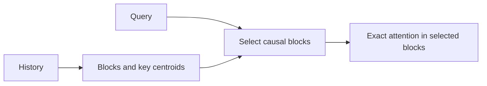
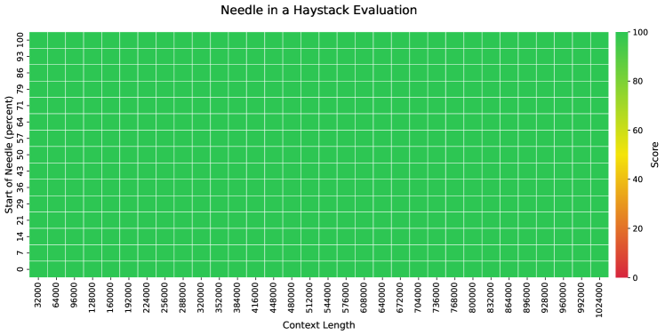

# MoBA: Mixture of Block Attention for Long-Context LLMs

<!-- source-sha256: 17cef51acf498da05db6213b5512c14b55c155bc6373b4cc0a9b0c1a31817bc1 -->

[简体中文](README.md)

> Core block-sparse routing and attention, not paper-scale context throughput.

## Paper information

| Field | Details |
|---|---|
| Paper | [arXiv 2502.13189](https://arxiv.org/abs/2502.13189) |
| Institution | Moonshot AI. |
| First public release | 2025-02-18 (arXiv v1) |
| Author code | [MoonshotAI/MoBA](https://github.com/MoonshotAI/MoBA). |
| Local adapter or method key | `moba` |
| Local reproduction code | [`src/auto_research/reproductions/moba/`](https://github.com/daiwk/auto-research/tree/main/src/auto_research/reproductions/moba/) |

## Paper method and evidence

Split sequences into blocks. A router chooses a few relevant blocks for each query while always retaining the current causal block.



<!-- paper-figure:start -->
### Original paper figure

[](https://ar5iv.labs.arxiv.org/html/2502.13189/assets/x12.png)

The original figure shows query-dependent block selection. From the [original paper](https://arxiv.org/abs/2502.13189); copyright remains with the authors.
<!-- paper-figure:end -->

### Core equation

$$
A(q)=\operatorname{softmax}(qK_{\mathcal B(q)}^\top)V_{\mathcal B(q)},\quad\mathcal B(q)=\operatorname{TopK}_b r(q,b).
$$

### Reported results

The paper approaches full-attention quality with sparse long-context training and scales to one million tokens.

## Local reproduction

Same parameter, token, optimizer and step budget: WikiText-2, 12 steps, 64d/two layers, seed 42; `llama_modern` → `moba` PPL **421.18→423.25 (+0.49%)**.

```bash
auto-research reproduce --paper moba --dataset-dir data --seed 42
auto-research evolve --model micro-llm --dataset wikitext-2 --direction "Combine moba with installed paper operators" --generations 2 --population 4
```

[Metrics](metrics/public-seed42.json). The reference uses 8-token blocks, top-2 causal blocks by query/key-centroid similarity, and exact attention over selected blocks. No fused million-context kernel.
