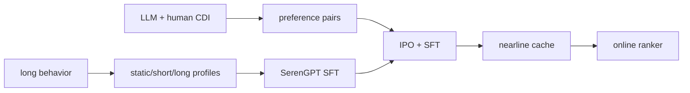
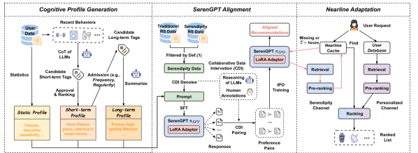

# SERAL: breaking recommendation filter bubbles with an aligned LLM

<!-- source-sha256: 4f39738a21993deab9f63b24bd99305cda7a84be6f5bd4be9679f8a7300608c7 -->

[简体中文](README.md)

> **Fidelity: full core path.** Runs static, short-term, and long-term cognition profiles; SFT; CDI preference pairs; IPO + SFT; and nearline full-catalog caching. Public content and collaborative signals replace GPT-4 and human labels.

## Paper information

| Field | Details |
|---|---|
| Paper | [arXiv 2502.13539](https://arxiv.org/abs/2502.13539) |
| Organization | Alibaba / Taobao |
| First public release | 2025-02-19 (arXiv v1) |
| Authors' code | The paper did not provide official or author code when checked on 2026-08-09. |
| Adapter / method | `seral` |
| Local reproduction code | [`src/auto_research/reproductions/seral/`](https://github.com/daiwk/auto-research/tree/main/src/auto_research/reproductions/seral/) |

## Original paper

### Motivation and method

Serendipitous recommendations must be relevant and previously unseen. SERAL compresses very long history into multilevel cognition profiles, uses LLM and human CDI to break the logging feedback loop, aligns SerenGPT with IPO, then generates and caches candidates nearline.

<!-- paper-figure:start -->
### Key figure from the paper

> **Figure 2:** Core architecture, modules, and their connections. From the [original paper](https://arxiv.org/abs/2502.13539); copyright remains with the authors.
<!-- paper-figure:end -->

### Core equations

$L_{SFT}=-\sum_t\log\pi_\theta(y_t|x,y_{<t})$; $L_{IPO}=E[(\log\frac{\pi_\theta(y_w)\pi_{ref}(y_l)}{\pi_{ref}(y_w)\pi_\theta(y_l)}-\frac{1}{2\tau})^2]$, with $L=L_{IPO}+\alpha L_{SFT}$.

### Paper results

Online serendipity PVR improves **+5.7%**, clicks **+29.56%**, and transactions **+27.6%**. The longer experiment reports UV3 +3.04% and transaction value +0.98%.

## Local reproduction

> **Local comparison:** Against common DIN, SERAL NDCG@10 is **+50.60%**. Adding CDI and IPO to the internal SFT-only baseline gives **+8.59%**, but novelty declines. Ranking and serendipity are reported separately.

180 users, 280 items, seeds 42–44. Common DIN at 100 steps yields Hit/NDCG 0.0481/0.02167; SERAL yields 0.0741/0.03263, or **+50.60%** relative NDCG. The internal IPO ablation improves **+8.59%** over SFT only, but category novelty falls 0.05542→0.05444, so the serendipity gain is not reproduced. See the [metrics](metrics/movielens-100k-seeds42-44.json).
