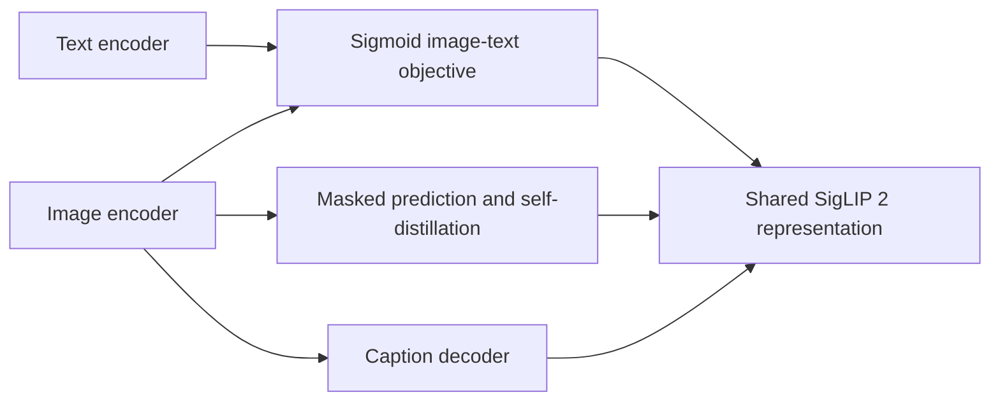
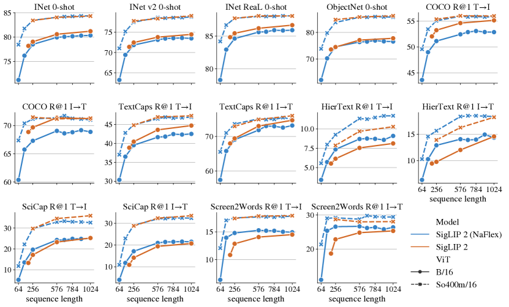

# SigLIP 2: sigmoid image–text alignment and masked-view self-distillation

<!-- source-sha256: 0559ef269b8459c8c2751365d13ebabda90d2e984ba2d78ca0b429afe059cbea -->

[简体中文](README.md)

> **Fidelity: core mechanism.** Runs sigmoid contrastive training and masked-view self-distillation, not multilingual web data, caption decoding, or dense localization.

## Paper information

| Field | Details |
|---|---|
| Paper | [arXiv 2502.14786](https://arxiv.org/abs/2502.14786) |
| Organization | Google DeepMind |
| First public release | 2025-02-20 (arXiv v1) |
| Authors' code | [Public implementation](https://github.com/google-research/big_vision) |
| Adapter / method | `siglip2` |
| Local reproduction code | [`src/auto_research/reproductions/siglip2/`](https://github.com/daiwk/auto-research/tree/main/src/auto_research/reproductions/siglip2/) |

## Original paper

### Motivation and method

SigLIP 2 extends SigLIP's pairwise sigmoid loss with captioning pretraining, global-local self-distillation, masked prediction, online data curation, and NaFlex dynamic resolution. This improves semantics, localization, dense features, and multilingual fairness.



<!-- paper-figure:start -->
### Key figure from the paper

[](https://ar5iv.labs.arxiv.org/html/2502.14786/assets/x3.png)

> **Figure 3:** Training flow and key optimization steps. From the [original paper](https://arxiv.org/abs/2502.14786); copyright remains with the authors.
<!-- paper-figure:end -->

### Core equation

$$
\mathcal L_{\mathrm{sigmoid}}=
\frac1{|B|}\sum_{i,j}\log\left(1+\exp\left[-z_{ij}
(t\,I_i^\top T_j+b)\right]\right),\quad z_{ij}\in\{-1,+1\}.
$$

### Paper results

All four model sizes outperform their SigLIP counterparts across zero-shot classification, retrieval, transfer, localization, and dense prediction. The authors release B/L/So400m/g checkpoints. No industrial online A/B is reported.

## Local reproduction

> **Local comparison:** Uniform label retrieval is `10.0%`. Sigmoid contrastive learning plus masked-view self-distillation reaches **66.9% test accuracy (+56.9 points)**; shuffling images drops it to 10.8%.

```bash
auto-research reproduce --paper siglip2 --dataset-dir data --seed 42
```

See the [fixed metrics](metrics/fashion-mnist-qa-seed42.json).

## Reproduction boundaries

Fashion-MNIST class text substitutes for multilingual captions. Sigmoid pair loss and center-masked student–teacher consistency train locally. Caption decoder, active curation, NaFlex, and localization head were not reproduced.
