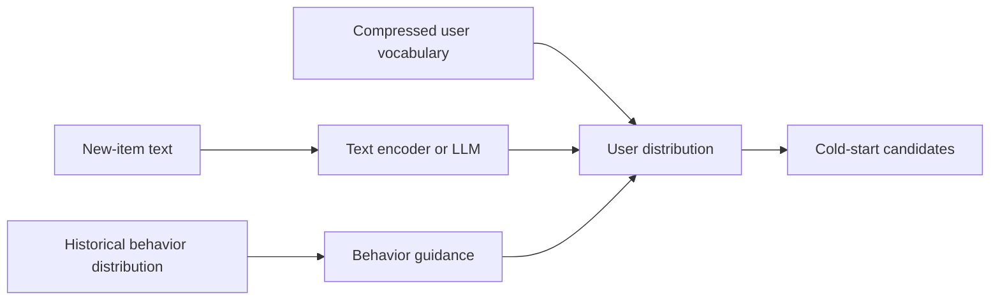
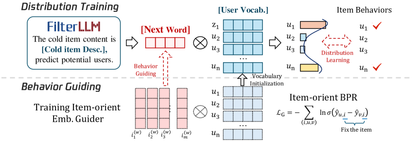

# FilterLLM: generating a user distribution directly from text

<!-- source-sha256: e8fe9275754a844245633b81657346684c4ab8c898b2dcdc47e788b4b14ec571 -->

[简体中文](README.md)

> **Fidelity: core mechanism.** Learns text-to-compressed-user-vocabulary distributions and constrains cold-start representations with behavioral distributions.

## Paper information

| Field | Details |
|---|---|
| Paper | [arXiv 2502.16924](https://arxiv.org/abs/2502.16924) |
| Organization | Alibaba |
| First public release | 2025-02-24 (arXiv v1) |
| Authors' code | The paper did not supply official or author code when checked on 2026-08-09. |
| Adapter / method | `filterllm` |
| Local reproduction code | [`src/auto_research/reproductions/filterllm/`](https://github.com/daiwk/auto-research/tree/main/src/auto_research/reproductions/filterllm/) |

## Original paper

### Motivation and method

Per-user judgments do not scale to cold starts for a billion users. FilterLLM maps product text once to a user distribution, compresses the output space with a user vocabulary, and uses historical behavior to guide distribution learning.



<!-- paper-figure:start -->
### Key figure from the paper

[](https://ar5iv.labs.arxiv.org/html/2502.16924/assets/x2.png)

> **Figure 2:** Core architecture, modules, and their connections. From the [original paper](https://arxiv.org/abs/2502.16924); copyright remains with the authors.
<!-- paper-figure:end -->

### Core equations

$$
p(u\mid x_i)=\operatorname{softmax}(W h(x_i)),\qquad
\mathcal L=-\sum_u q(u\mid i)\log p(u\mid x_i).
$$

### Paper results

Offline cold-start retrieval beats per-user LLM judgment. Online against ColdLLM: Cold-PV `+5.13%`, PCTR `+3.93%`, GMV `+10.86%`, and inference time `-97.12%`.

## Local reproduction

> **Local comparison:** NDCG@10 is `-9.82%` against a content-to-item judgment baseline.

On the same full-catalog MovieLens-1M protocol, NDCG@10 changes `0.07514→0.06776` (`-9.82%`) and Hit@10 `0.14048→0.12619`. This negative result shows that genre-text proxies are insufficient to reproduce industrial new-product text gains. See the [metrics](metrics/movielens-1m-seed42.json).

```bash
auto-research reproduce --paper filterllm --dataset-dir data --seed 42
```

## Reproduction boundaries

SVD on public interactions supplies the compressed user vocabulary, not billion-user LLM tokens. There is no Taobao new-product text, traffic, or latency stack.
